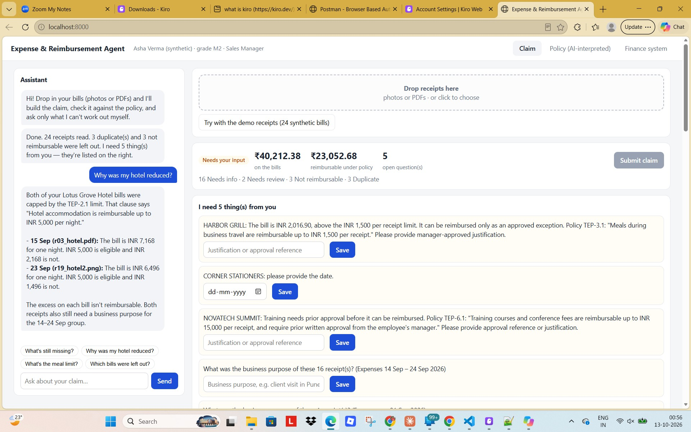
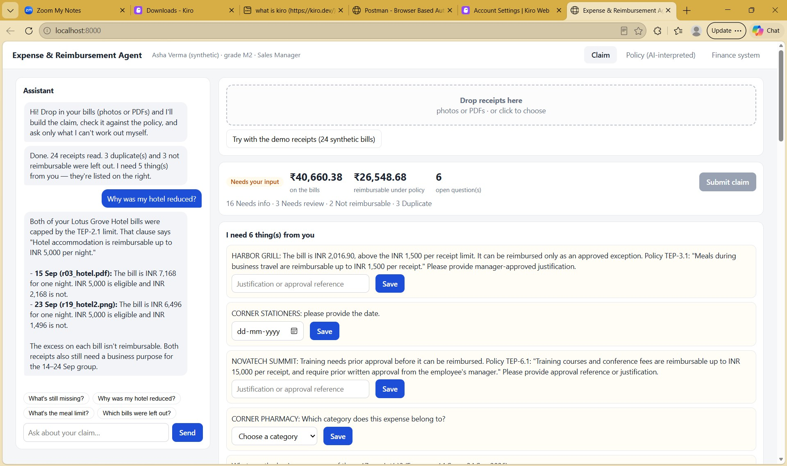
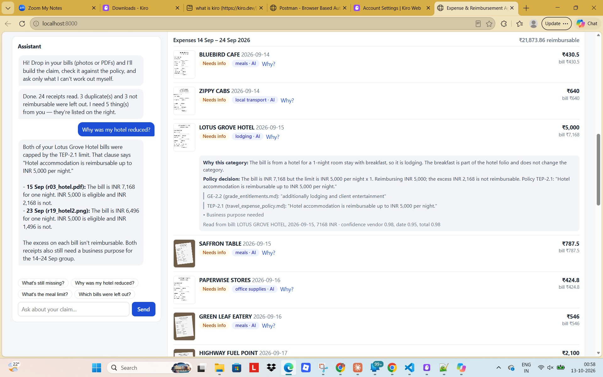
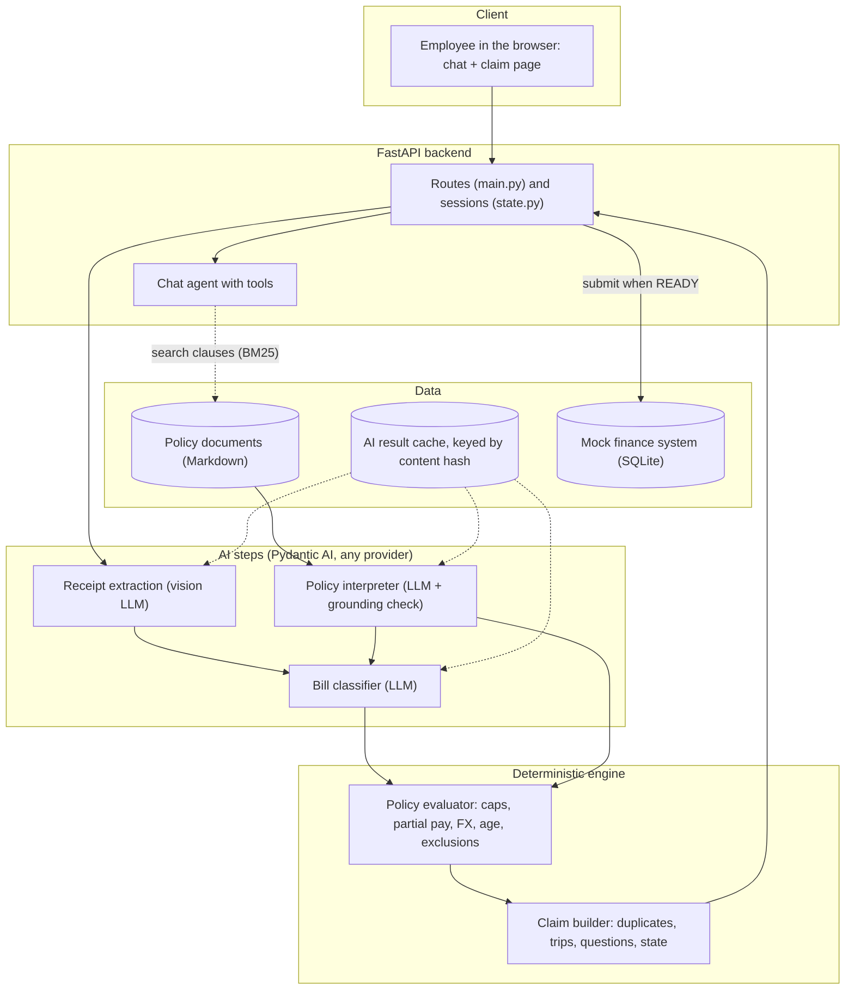

# Expense & Reimbursement Agent

**Competition track: Track 1, "Expense & Reimbursement Agent".** An AI-native assistant that turns a pile of receipts into a policy-checked,
explained, submission-ready reimbursement claim.

An employee drops in bills (photos, PDFs). The system reads them, works out what each expense is, **reads the company's policy documents to decide what is
reimbursable and why**, removes duplicates, asks only the questions it cannot answer itself, and prepares the claim for a (mock) finance system.
Change one sentence in a policy document and the next claim uses the new rule, with **no code change**.

> All data is synthetic (fictional company, policies, employee and receipts). See [DATA_POLICY.md](DATA_POLICY.md).

| | |
|---|---|
| **Demo video (YouTube)** | https://youtu.be/cBqzs7ioSiY |
| **Team / author** | shivaprasad.c@ril.com |

## Documentation
| Document | What it contains |
|---|---|
| [docs/TECHNICAL_DESIGN.md](docs/TECHNICAL_DESIGN.md) | Overview and track, requirements traceability, **architecture and flow diagrams**, AI design, claim logic, data model, code walkthrough, **assumptions**, security |
| [docs/SETUP_AND_DEPLOYMENT.md](docs/SETUP_AND_DEPLOYMENT.md) | Install, configuration, running, tests, **Docker**, hosting recipes, troubleshooting |
| [docs/TEST_REPORT.md](docs/TEST_REPORT.md) | 133 tests, 100% coverage, strategy, live-LLM evaluation, defects found and fixed, honest limits |
| [docs/EVALUATION_MAPPING.md](docs/EVALUATION_MAPPING.md) | How each rule and evaluation criterion is addressed |
| [docs/BUSINESS_IMPACT.md](docs/BUSINESS_IMPACT.md) | Measured results and an assumption-based time-saving model |




## What makes it AI-native, not rule-based
Policies are **documents, not code**. An LLM interprets them into structured constraints, each backed by a verbatim quote that code verifies; deterministic
code then enforces them with exact arithmetic.



| Capability | How |
|---|---|
| Understand eligibility by employee profile | LLM extracts the entitlement matrix from the policy documents; code matches it to the employee's grade |
| Classify each bill into the employee's categories | LLM, with its reasoning shown to the user |
| Interpret policy limits and conditions | LLM extracts limits, units, grades, partial-reimbursement behaviour and a **verbatim quote** per item |
| Validate and recommend the eligible amount | Deterministic code: caps per receipt / night / day / month, partial reimbursement, FX conversion |
| Adapt to policy changes with no code change | Interpretation is cached by document hash; editing a document triggers re-interpretation |
| Explainable decisions | Category reasoning, clause reference (e.g. `TEP-2.1`), the quote, the arithmetic and what is still needed |
| Reliable execution | LLM output is verified (quote must appear in the clause, numbers in the quote) and retried on failure; money is never computed by an LLM |



## Architecture

More diagrams (processing sequence, policy interpretation with the grounding loop, the decision procedure, state machines, data model, deployment) are in
[docs/TECHNICAL_DESIGN.md](docs/TECHNICAL_DESIGN.md).

| Component | Technique | Why |
|---|---|---|
| Receipt extraction | LLM (vision) | Messy photos need it |
| Policy interpretation | LLM + deterministic grounding check | Policies are prose; the quote check stops invented limits |
| Clause retrieval | RAG (BM25 over clauses) | Offline and free; cites the exact clause |
| Bill classification | LLM (text, with the policy's categories) | A judgement call that must be explained |
| Amounts, caps, partial pay, FX | Deterministic | Financial accuracy, reproducible |
| Duplicates, grouping, claim state, questions | Deterministic | Auditable (image hashing was measured and rejected) |
| Employee conversation | Agent (Pydantic AI with tools) | Open-ended follow-ups; the agent reads decisions, it does not make them |

## Results (24 synthetic receipts, Claude Sonnet 5.5)
| Metric | Result |
|---|---|
| Extraction: vendor, date, total, currency | 24 / 24 (blurry, crumpled, PDF, USD and SGD included) |
| Category classification | 21 / 24 (88%; classification accuracy is LLM-dependent and varies by model) |
| Duplicates found (exact + re-photographed) | 3 / 3, 0 false alarms |
| Questions the employee must answer | 5 for 24 receipts |
| Policy edit (hotel 5,000 -> 7,000) | Reimbursable INR 23,053 -> INR 26,549, no code change |
| Tests | **133 passing, 100% statement coverage**, lint clean |

Gemini 3.8 Flash (free tier) interpreted the policy identically and the 5 receipts that completed were all correct; 3 others hit HTTP 503 "high demand", so no
full-set figure is claimed. Raw metrics: `data/eval/`.

## Quick start
```bash
python3 -m venv .venv && source .venv/bin/activate
pip install -r backend/requirements.txt
cp .env.example .env            # add ANTHROPIC_API_KEY (or GOOGLE_API_KEY + LLM_MODEL=google:gemini-3.8-flash)
cd backend && CLAIM_TODAY=2026-10-12 uvicorn app.main:app --port 8000
# open http://localhost:8000  ->  "Try with the demo receipts"
```
The demo receipts, the interpreted policy and the classifications are cached in `data/cache/`, so the demo button works **without network access or an API
key**. Chat, new uploads and policy edits call the LLM. Docker: `docker compose up --build` (see [docs/SETUP_AND_DEPLOYMENT.md](docs/SETUP_AND_DEPLOYMENT.md)).

```bash
pip install -r backend/requirements-dev.txt
cd backend && python -m pytest -q --cov=app            # 133 passed, 100% coverage, offline
cd .. && ruff check backend tools                      # lint
python tools/run_pipeline.py --today 2026-10-12        # live-LLM evaluation against ground truth (needs a key)
```

## Layout
```
backend/app/       ingest, extraction, policy/{schema,clauses,interpreter,evaluator}, classifier, duplicates, grouping, claim,
                   pipeline, state, chat, finance, main
backend/tests/     133 tests          frontend/index.html   single-page UI (no build step)
tools/             data generator, evaluation CLI, deck builder
data/              fictional policies + employee, synthetic receipts + ground truth, cached AI results, metrics
docs/              design, setup, test report, evaluation mapping, business impact, demo and submission guides
Dockerfile  docker-compose.yml  pyproject.toml  .github/workflows/ci.yml
```

## Known limitations
Synthetic bills only; one employee and one policy set; no authentication; static illustrative FX rates; one category per bill; hotel nights taken from the bill
(defaults to one); policy interpretation assumes clearly numbered clauses; the web UI is verified manually, not by automated tests. Full list:
[docs/TECHNICAL_DESIGN.md](docs/TECHNICAL_DESIGN.md) section 9 and [docs/TEST_REPORT.md](docs/TEST_REPORT.md) section 5.
