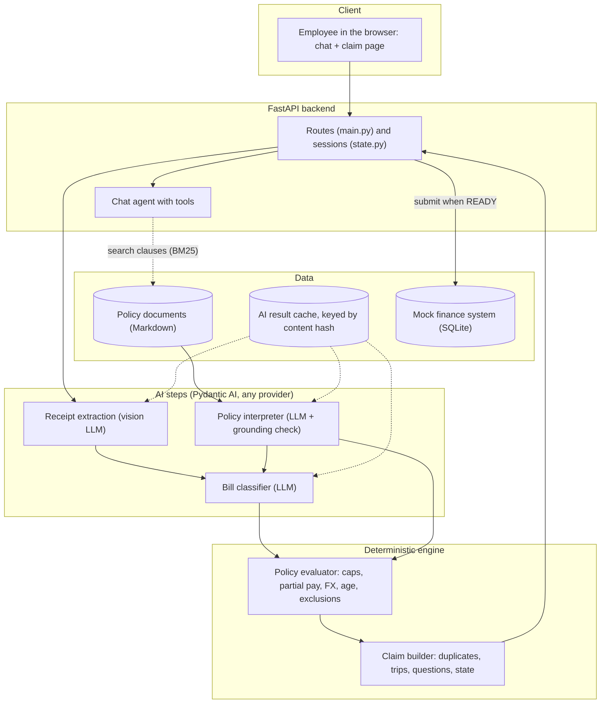
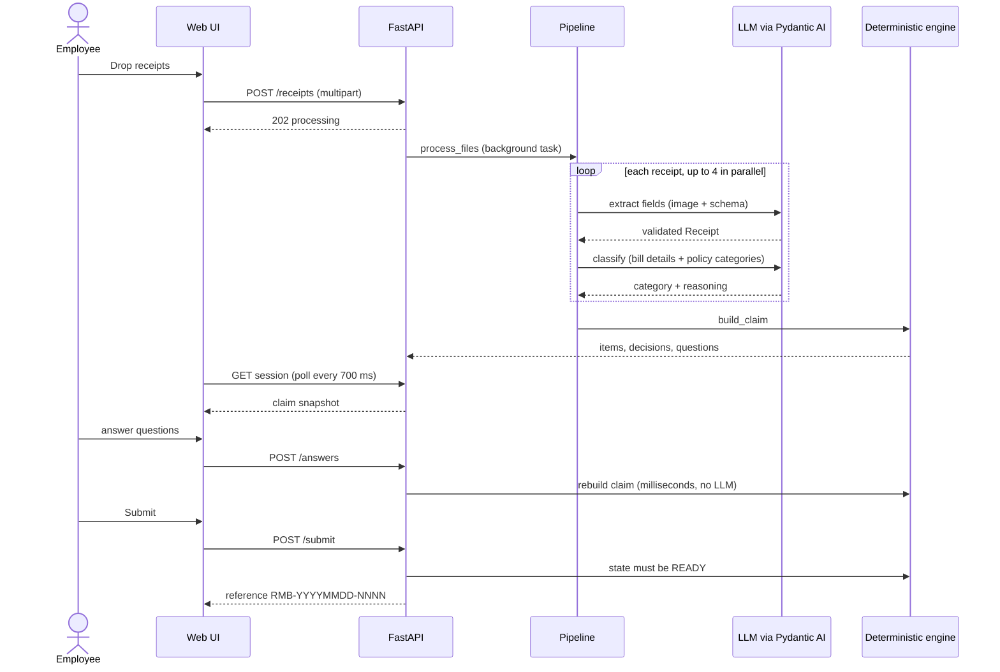
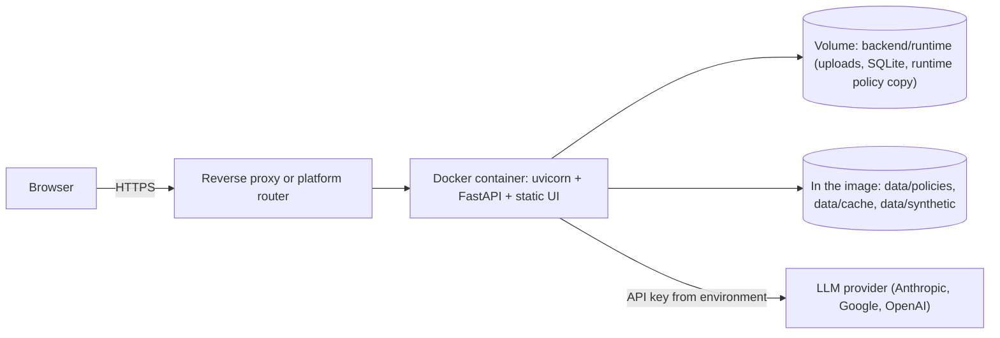
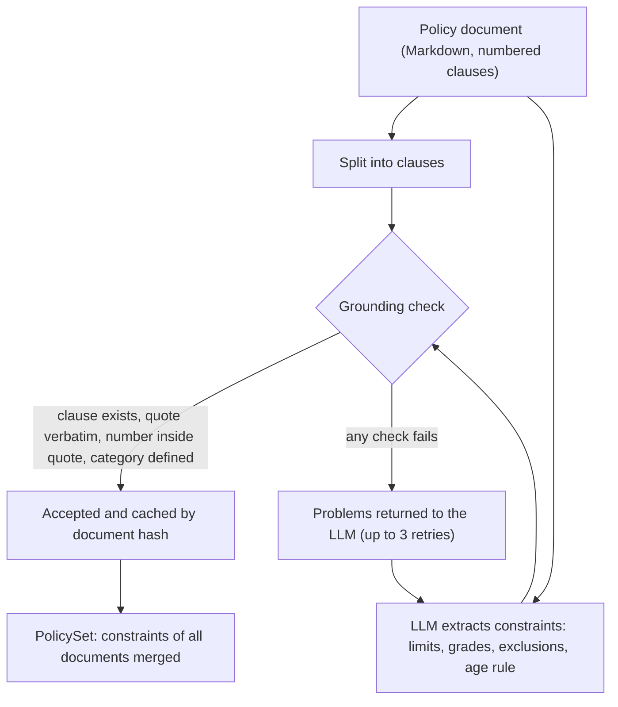
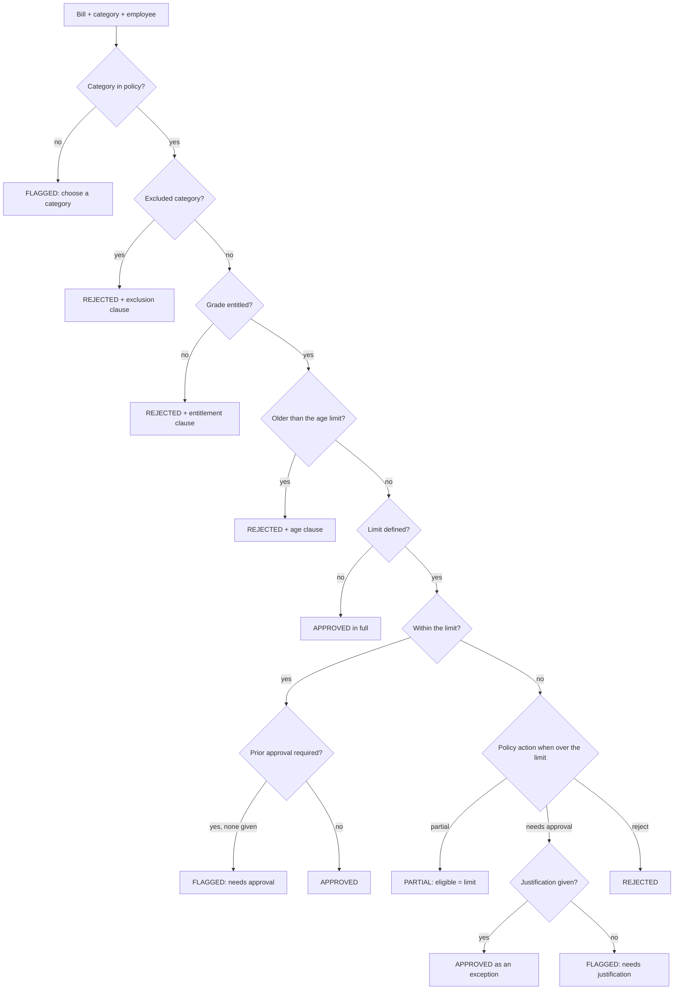
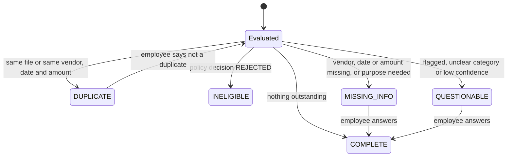
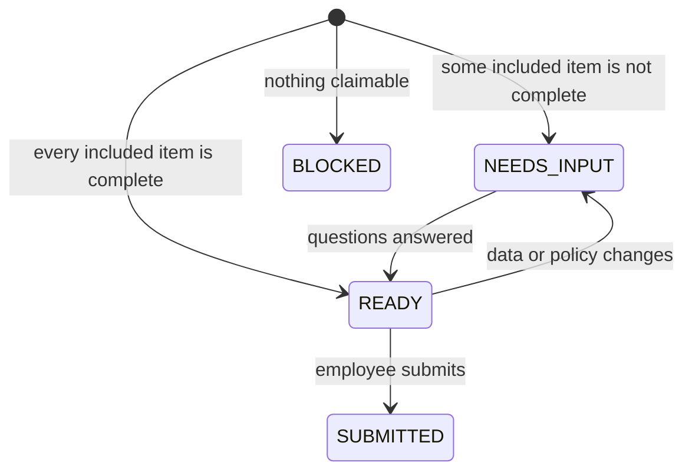
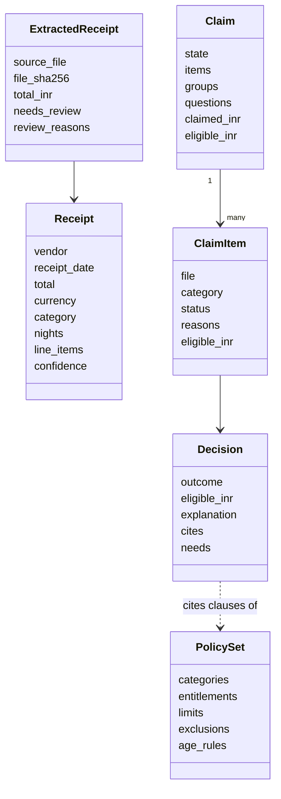

# A5 — verbatim source: documentation (README and docs/)

Create every file below at the given path with **exactly** the content between the fences (the fence lines themselves are not part of the file). Each file ends with a single trailing newline. Do not change anything. Create missing folders as needed. A file marked `(empty file)` must be created empty. Some fences are four backticks long because the file itself contains three-backtick code blocks; the fence that closes a file has the same length as the one that opened it.

Note: the documents refer to `docs/screenshots/*.jpg` (five images). Those are binary and not included; capture them as described in `09_DOCUMENTATION_VIDEO_AND_SUBMISSION.md` section 4. Placeholders `YOUR_YOUTUBE_URL`, `YOUR_HOSTED_URL`, `YOUR_NAME` and `<YOUR GITHUB REPO URL>` are intentional and are filled in by the human.

### FILE: README.md  (146 lines)

````markdown
# Expense & Reimbursement Agent

**Competition track: Track 1, "Expense & Reimbursement Agent".** An AI-native assistant that turns a pile of receipts into a policy-checked,
explained, submission-ready reimbursement claim.

An employee drops in bills (photos, PDFs). The system reads them, works out what each expense is, **reads the company's policy documents to decide what is
reimbursable and why**, removes duplicates, asks only the questions it cannot answer itself, and prepares the claim for a (mock) finance system.
Change one sentence in a policy document and the next claim uses the new rule, with **no code change**.

> All data is synthetic (fictional company, policies, employee and receipts). See [DATA_POLICY.md](DATA_POLICY.md).

| | |
|---|---|
| **Demo video (YouTube)** | YOUR_YOUTUBE_URL |
| **Hosted demo (optional)** | YOUR_HOSTED_URL (or "not hosted") |
| **Team / author** | YOUR_NAME |

## Documentation
| Document | What it contains |
|---|---|
| [docs/TECHNICAL_DESIGN.md](docs/TECHNICAL_DESIGN.md) | Overview and track, requirements traceability, **architecture and flow diagrams**, AI design, claim logic, data model, code walkthrough, **assumptions**, security |
| [docs/SETUP_AND_DEPLOYMENT.md](docs/SETUP_AND_DEPLOYMENT.md) | Install, configuration, running, tests, **Docker**, hosting recipes, troubleshooting |
| [docs/TEST_REPORT.md](docs/TEST_REPORT.md) | 133 tests, 100% coverage, strategy, live-LLM evaluation, defects found and fixed, honest limits |
| [docs/EVALUATION_MAPPING.md](docs/EVALUATION_MAPPING.md) | How each rule and evaluation criterion is addressed |
| [docs/BUSINESS_IMPACT.md](docs/BUSINESS_IMPACT.md) | Measured results and an assumption-based time-saving model |
| [docs/DEMO_VIDEO_GUIDE.md](docs/DEMO_VIDEO_GUIDE.md), [docs/SUBMISSION_CHECKLIST.md](docs/SUBMISSION_CHECKLIST.md) | Video script and upload steps; GitHub and submission steps |


## What makes it AI-native, not rule-based
Policies are **documents, not code**. An LLM interprets them into structured constraints, each backed by a verbatim quote that code verifies; deterministic
code then enforces them with exact arithmetic.


| Capability | How |
|---|---|
| Understand eligibility by employee profile | LLM extracts the entitlement matrix from the policy documents; code matches it to the employee's grade |
| Classify each bill into the employee's categories | LLM, with its reasoning shown to the user |
| Interpret policy limits and conditions | LLM extracts limits, units, grades, partial-reimbursement behaviour and a **verbatim quote** per item |
| Validate and recommend the eligible amount | Deterministic code: caps per receipt / night / day / month, partial reimbursement, FX conversion |
| Adapt to policy changes with no code change | Interpretation is cached by document hash; editing a document triggers re-interpretation |
| Explainable decisions | Category reasoning, clause reference (e.g. `TEP-2.1`), the quote, the arithmetic and what is still needed |
| Reliable execution | LLM output is verified (quote must appear in the clause, numbers in the quote) and retried on failure; money is never computed by an LLM |


## Architecture

More diagrams (processing sequence, policy interpretation with the grounding loop, the decision procedure, state machines, data model, deployment) are in
[docs/TECHNICAL_DESIGN.md](docs/TECHNICAL_DESIGN.md).

| Component | Technique | Why |
|---|---|---|
| Receipt extraction | LLM (vision) | Messy photos need it |
| Policy interpretation | LLM + deterministic grounding check | Policies are prose; the quote check stops invented limits |
| Clause retrieval | RAG (BM25 over clauses) | Offline and free; cites the exact clause |
| Bill classification | LLM (text, with the policy's categories) | A judgement call that must be explained |
| Amounts, caps, partial pay, FX | Deterministic | Financial accuracy, reproducible |
| Duplicates, grouping, claim state, questions | Deterministic | Auditable (image hashing was measured and rejected) |
| Employee conversation | Agent (Pydantic AI with tools) | Open-ended follow-ups; the agent reads decisions, it does not make them |

## Results (24 synthetic receipts, Claude Sonnet 5.5)
| Metric | Result |
|---|---|
| Extraction: vendor, date, total, currency | 24 / 24 (blurry, crumpled, PDF, USD and SGD included) |
| Category classification | 23 / 24 |
| Duplicates found (exact + re-photographed) | 3 / 3, 0 false alarms |
| Questions the employee must answer | 5 for 24 receipts |
| Policy edit (hotel 5,000 -> 7,000) | Reimbursable INR 23,053 -> INR 26,549, no code change |
| Tests | **133 passing, 100% statement coverage**, lint clean |

Gemini 3.8 Flash (free tier) interpreted the policy identically and the 5 receipts that completed were all correct; 3 others hit HTTP 503 "high demand", so no
full-set figure is claimed. Raw metrics: `data/eval/`.

## Quick start
```bash
python3 -m venv .venv && source .venv/bin/activate
pip install -r backend/requirements.txt
cp .env.example .env            # add ANTHROPIC_API_KEY (or GOOGLE_API_KEY + LLM_MODEL=google:gemini-3.8-flash)
cd backend && CLAIM_TODAY=2026-10-12 uvicorn app.main:app --port 8000
# open http://localhost:8000  ->  "Try with the demo receipts"
```
The demo receipts, the interpreted policy and the classifications are cached in `data/cache/`, so the demo button works **without network access or an API
key**. Chat, new uploads and policy edits call the LLM. Docker: `docker compose up --build` (see [docs/SETUP_AND_DEPLOYMENT.md](docs/SETUP_AND_DEPLOYMENT.md)).

```bash
pip install -r backend/requirements-dev.txt
cd backend && python -m pytest -q --cov=app            # 133 passed, 100% coverage, offline
cd .. && ruff check backend tools                      # lint
python tools/run_pipeline.py --today 2026-10-12        # live-LLM evaluation against ground truth (needs a key)
```

## Layout
```
backend/app/       ingest, extraction, policy/{schema,clauses,interpreter,evaluator}, classifier, duplicates, grouping, claim,
                   pipeline, state, chat, finance, main
backend/tests/     133 tests          frontend/index.html   single-page UI (no build step)
tools/             data generator, evaluation CLI, deck builder
data/              fictional policies + employee, synthetic receipts + ground truth, cached AI results, metrics
docs/              design, setup, test report, evaluation mapping, business impact, demo and submission guides
Dockerfile  docker-compose.yml  pyproject.toml  .github/workflows/ci.yml
```

## Known limitations
Synthetic bills only; one employee and one policy set; no authentication; static illustrative FX rates; one category per bill; hotel nights taken from the bill
(defaults to one); policy interpretation assumes clearly numbered clauses; the web UI is verified manually, not by automated tests. Full list:
[docs/TECHNICAL_DESIGN.md](docs/TECHNICAL_DESIGN.md) section 9 and [docs/TEST_REPORT.md](docs/TEST_REPORT.md) section 5.
````

### FILE: docs/TECHNICAL_DESIGN.md  (481 lines)

````markdown
# Technical Design Document

**Project:** Expense & Reimbursement Agent  
**Competition track selected:** **Track 1 — "Expense & Reimbursement Agent"** (an AI-native assistant that turns a pile of
receipts into a submission-ready reimbursement claim)  
**Status:** complete and tested. 133 automated tests, 100% statement coverage of the `app/` package, lint clean.  
**Data:** 100% synthetic; the company ("Acme Corp"), policies, employee and receipts are fictional (see `DATA_POLICY.md`).

Contents: [1 Overview](#1-project-overview) · [2 Requirements](#2-requirements-and-traceability) ·
[3 Architecture](#3-system-architecture) · [4 AI design](#4-ai-design) · [5 Claim logic](#5-claim-logic) ·
[6 Data model](#6-data-model) · [7 API and UI](#7-api-and-ui) · [8 Code walkthrough](#8-code-walkthrough) ·
[9 Assumptions](#9-assumptions-and-limitations) · [10 Security and privacy](#10-security-and-privacy) ·
[11 Testing](#11-testing-and-reliability) · [12 Setup and deployment](#12-setup-and-deployment) · [13 Future work](#13-future-work)

---

## 1. Project overview

### 1.1 Problem (Track 1)
Employees regularly spend time collecting bills, entering details, categorising expenses, checking what is allowed and
preparing reimbursement claims. The track asks for an AI-native reimbursement assistant on a familiar interface (chat) where an
employee drops in photographs, PDFs or other bills and the system does as much of the work as possible: understand receipts,
extract information, group expenses, notice missing details, ask only necessary questions, check basic rules, identify possible
duplicates and prepare a submission-ready claim. The corporate reimbursement system may be mocked.

### 1.2 Solution in one paragraph
The employee drops bills into a web chat page. A vision LLM reads every bill into a validated structure. A second LLM step **reads the
company's policy documents** and converts them into structured, **quote-grounded constraints**; a third classifies each bill into the
employee's policy categories and explains why. **Deterministic code** then applies the constraints with exact arithmetic (caps per
receipt/night/day/month, partial reimbursement, FX conversion, age limit, exclusions, grade entitlements), removes duplicates, groups bills
into trips and works out the **minimum set of questions** the employee must answer. An agent in the chat explains any decision with the policy
clause and a verbatim quote, searches the policy, and records answers. A ready claim is submitted to a mock finance system (SQLite).
**Editing a policy document changes the outcome without any code change.**

### 1.3 What is novel
| Idea | Why it matters |
|---|---|
| **Policy as a document, interpreted by AI, enforced by code** | No limits or eligibility rules are hard-coded (`grep` finds none in `backend/app`). Change one sentence in a policy and the next claim uses it |
| **Grounding check on every AI-extracted rule** | A constraint is accepted only if its clause exists, its quote is verbatim, its number is inside that quote and its category is defined; failures are fed back to the LLM. This is what makes LLM-read policy safe for money |
| **Explanations that cite the exact clause** | Every decision carries clause references (e.g. `TEP-2.1`), the verbatim quote, the arithmetic and what is still needed |
| **Minimum questions** | 24 bills produce 5 questions: one business-purpose question per trip, none for bills the policy already rejected, clarification only when the answer changes the outcome *and* the model is unsure |
| **Measured engineering decisions** | Image hashing for duplicates was tested and rejected (different bills hashed identically); duplicates use content equality with a bill-number guard |
| **Model-agnostic, offline-capable** | `LLM_MODEL` switches providers; AI results are cached by content hash, so the demo runs with no key or network |

### 1.4 Scope
In scope: bill reading, policy interpretation, classification, validation, explanation, duplicate detection, grouping, minimal questions,
chat assistant, mock submission, evaluation harness, tests, deployment recipe. Out of scope / mocked: the real finance platform, authentication,
real HRMS employee data, approval workflows, live FX rates.

---

## 2. Requirements and traceability

| # | Requirement (brief or added AI requirement) | Feature | Module(s) | Tests |
|---|---|---|---|---|
| T1 | Understand receipts, extract information | Vision extraction into a validated `Receipt` | `ingest.py`, `extraction.py`, `models.py`, `quality.py` | `test_ingest`, `test_extraction`, `test_quality` |
| T2 | Group expenses | Date-proximity trip groups | `grouping.py` | `test_grouping` |
| T3 | Notice missing details, ask only necessary questions | Missing-field, purpose, justification, clarification questions | `claim.py` | `test_claim`, `test_edge_cases` |
| T4 | Check basic rules | Deterministic policy evaluation | `policy/evaluator.py` | `test_policy_evaluator`, `test_edge_cases` |
| T5 | Identify duplicates | Identical-file and same-bill detection | `duplicates.py` | `test_duplicates` |
| T6 | Submission-ready claim; mock finance | Claim state machine, SQLite submission | `claim.py`, `finance.py` | `test_claim`, `test_finance`, `test_api` |
| T7 | Fastest, clearest user experience | Chat + claim page, one-click demo, inline answers | `frontend/index.html`, `chat.py` | `test_api`, `test_chat_helpers` |
| A1 | AI-based eligibility identification | LLM reads entitlement matrix; code matches the employee's grade | `policy/interpreter.py`, `policy/schema.py` | `test_policy_interpreter`, `test_policy_evaluator` |
| A2 | Intelligent bill classification and mapping | LLM classifier into the policy's own categories, with reasoning | `classifier.py` | `test_classifier` |
| A3 | AI-powered policy interpretation and validation | Interpreter + evaluator, partial reimbursement recommended | `policy/*` | `test_policy_*` |
| A4 | Adapt to policy changes with no code change | Cache by document hash; UI policy editor; claims recomputed | `policy/interpreter.py`, `state.py`, `main.py` | `test_state`, `test_api` |
| A5 | Explainable decisions | Category reasoning, clause citation, quote, amounts, needs | `policy/evaluator.py`, `claim.py`, UI "Why?" | `test_policy_evaluator`, `test_claim` |
| A6 | Reliable execution | AI proposes, deterministic code enforces; grounding, retries, caching | whole backend | all |

---

## 3. System architecture

### 3.1 Component architecture


### 3.2 Processing flow (one upload)



### 3.3 Deployment view



### 3.4 Technology choices
| Layer | Choice | Why |
|---|---|---|
| Language | Python 3.11+ | Best ecosystem for LLM tooling and PDF/image handling |
| AI framework | **Pydantic AI 2.x** | Typed structured output, automatic validation retries, tools, provider-agnostic model strings; far lighter than LangChain/LangGraph for a fixed pipeline |
| Models | Claude Sonnet 5.5 (default); Gemini verified on free tier | Vision + structured output; swap with one env var |
| API | FastAPI + uvicorn | Async, typed, auto-docs at `/docs` |
| PDF/image | PyMuPDF, Pillow | Rasterise PDFs, strip EXIF, resize |
| Retrieval | BM25 (own 30-line implementation) | Two short documents do not justify embeddings; offline, deterministic, free |
| Storage | SQLite (stdlib `sqlite3`) for the mock finance system; in-memory sessions | No infrastructure to run |
| UI | One HTML file, plain JavaScript | No build step; DOM built without `innerHTML` (model output is untrusted) |
| Quality | pytest, pytest-cov, ruff, GitHub Actions | Tests, coverage gate, lint |

---

## 4. AI design

### 4.1 Where LLMs are used, and where they are not

| Step | Technique | Rationale |
|---|---|---|
| Receipt extraction | LLM (vision) | Photos and PDFs are messy |
| Policy interpretation | LLM + deterministic grounding check | Policies are prose that changes |
| Classification | LLM (text) with the policy's categories | A judgement call that must be explained |
| Amounts, caps, partial pay, FX, age limit | **Deterministic** | Financial accuracy, reproducibility, audit |
| Duplicates, grouping, statuses, questions | **Deterministic** | Testable, explainable |
| Chat | Agent with tools | Open-ended follow-ups; it reads decisions and records answers, code decides |
| Clause lookup | RAG (BM25) | Cites the exact clause in answers |

### 4.2 Receipt extraction (`extraction.py`, `ingest.py`)
1. `ingest.py` re-encodes every image to JPEG (this **drops EXIF/GPS**), resizes to at most 1,600 px, rasterises up to 3 PDF pages at 150 dpi
   and captures any embedded PDF text. The SHA-256 of the original bytes identifies the file.
2. A Pydantic AI agent with `output_type=Receipt` returns vendor, date, total, tax, currency, a free-text expense description, hotel nights,
   line items, bill number and **per-field confidence**. Field validators (e.g. 3-letter currency code) trigger automatic LLM retries.
3. `quality.assess_receipt` adds deterministic review reasons (missing fields, confidence < 0.7, line items not adding up to the total within 2%).
4. The **file name is never sent** to the model (it could leak the expected answer); a test enforces this.
5. Results are cached by file hash + model. Transient errors (HTTP 429/503, dropped connection) retry with 2, 4, 8, 16, 30 s back-off; a *daily*
   quota error is not retried because waiting cannot help.

### 4.3 Policy interpretation with a grounding check (`policy/interpreter.py`)



The LLM fills a `PolicyConstraints` object: `categories`, `entitlements` (category → grade codes), `limits` (amount, unit
`per_receipt|per_night|per_day|per_month`, grades, what happens over the limit: `partial|needs_approval|reject`, whether prior approval is required),
`exclusions` and `age_rules`. `grounding_problems()` verifies, for every item: the clause number exists; the quote is a whitespace- and
case-insensitive substring of that clause; the category id is defined in the same output; for limits and age rules, the number appears in the
quote. Violations are returned to the model as a `ModelRetry` listing each problem. Later documents are told the category ids defined by earlier
ones so documents agree on ids. **Because results are cached by the document's content hash, editing the document is the only thing needed for new
limits to apply.**

### 4.4 Classification (`classifier.py`)
A text-only LLM call receives the employee (grade, role), the policy's categories with a label for this employee
(`available to grade M2`, `NOT available`, `never reimbursable`) and the extracted bill. It returns one category id (validated against the policy),
a reasoning sentence, a confidence and, only when the choice would change the outcome, a clarification question. The instructions forbid asking
about things collected elsewhere (purpose, date, amount, tax). In code, a clarification is only shown if confidence is also below 0.75. This removed
four unnecessary questions in testing.

### 4.5 Deterministic evaluation (`policy/evaluator.py`)



Worked example from the brief: hotel limit INR 5,000 per night, bill INR 7,168 → `PARTIAL`, eligible INR 5,000, explanation
*"The bill is INR 7,168 but the limit is INR 5,000 per night x 1. Reimbursing INR 5,000; the excess INR 2,168 is not reimbursable. Policy TEP-2.1: "Hotel accommodation is reimbursable up to INR 5,000 per night.""*
with citations `GE-2.2` (why a manager may claim lodging) and `TEP-2.1`. Per-day and per-month limits are shared across receipts through a
`UsageTracker`. Grade-specific limits take precedence over general ones. Foreign currency is converted first.

### 4.6 Chat agent and retrieval (`chat.py`, `policy/clauses.py`)
A Pydantic AI agent with four tools: `claim_status`, `explain_item`, `search_policy` (BM25 over clauses; returns references such as `TEP-2.1`) and
`record_answer` (validated, then the claim is rebuilt by code). The agent's instructions forbid guessing amounts or policy and tell it to cite clause
references. It never decides: all numbers come from tool output produced by deterministic code.

### 4.7 Reliability engineering
| Risk | Mitigation |
|---|---|
| LLM invents a limit | Grounding check; retries with the exact problems listed |
| LLM returns malformed data | Pydantic validation + automatic retries; then a clear "enter manually" path, never a crash |
| Rate limits / overload / network drop | Back-off retries; daily quota not retried; per-file failure isolation |
| Provider outage or no key during a demo | Content-hash caches make the demo run offline |
| Privacy leakage via photos | EXIF/GPS stripped on re-encode |
| Prompt-leaking filenames | File name never sent |
| Untrusted model text in the UI | DOM built with `textContent`; only `**bold**` rendered, as `<b>` nodes |

### 4.8 Measured results (24 synthetic receipts, Claude Sonnet 5.5)
Extraction of vendor, date, total, currency: **24/24**. Category: **23/24** (the miss is an arguable 4-person tasting menu). Duplicates:
**3/3**, no false alarms. Questions asked: **5 for 24 bills**. Policy edit (hotel 5,000 → 7,000): reimbursable total INR 23,053 → INR 26,549 with no code
change. Gemini 3.8 Flash (free tier) interpreted the policy identically; of 8 receipts attempted, 5 completed (all correct) and 3 hit HTTP 503 overload, so no
full-set figure is claimed. Raw metrics: `data/eval/`.

---

## 5. Claim logic (`claim.py`, `duplicates.py`, `grouping.py`)

**Duplicates.** Walk the receipts in order; a receipt duplicates the first earlier one that has the identical file hash or the same date, currency,
amount (±0.01) and a similar vendor (`difflib` ratio ≥ 0.85 on normalised names). If both bills have bill numbers and they differ, they are two real
purchases. Image hashing was measured and rejected: on same-template receipts different bills had hash distance 0 and a re-photographed duplicate
had distance 34.

**Trips.** Dated bills are sorted; a bill within 3 days of the previous one joins its group; otherwise a new group starts (`g-<ISO start date>`).

**Item and claim states**





**Minimal questions.** `field` (basics first, then nothing else for that bill), `clarify` (only if outcome-relevant and confidence < 0.75),
`justify` (flagged by policy), `confirm` (low-confidence extraction), and one `purpose` per trip group. Bills already rejected ask nothing.

---

## 6. Data model



Persistence: sessions live in memory; submitted claims are stored in SQLite table `claims(id, created_at, employee_id, employee_name, grade,
claimed_inr, eligible_inr, status, payload JSON)` with references `RMB-YYYYMMDD-NNNN`. AI results are JSON files under `data/cache/` keyed by
content hash.

---

## 7. API and UI

| Endpoint | Purpose |
|---|---|
| `POST /api/sessions` | new session |
| `POST /api/sessions/{id}/receipts` | upload bills (202, background processing) |
| `POST /api/sessions/{id}/demo` | load the 24 bundled synthetic bills |
| `GET /api/sessions/{id}` | poll status and claim snapshot |
| `POST /api/sessions/{id}/answers` | answer a question or correct a field |
| `POST /api/sessions/{id}/chat` | talk to the agent |
| `POST /api/sessions/{id}/submit` | submit a ready claim to the mock finance system |
| `GET/PUT /api/policy`, `POST /api/policy/reset` | view, edit and restore policy documents |
| `GET /api/finance/claims[/{id}]` | submitted claims |
| `GET /api/health` | liveness and configured model |

Interactive docs: `/docs` (FastAPI). UI: chat on the left, claim on the right (summary, open questions with inline inputs, bills grouped by trip with
status chips, a **Why?** panel per bill), a **Policy** tab (edit text, see what the AI extracted) and a **Finance** tab.

---

## 8. Code walkthrough

| File | Responsibility and key points |
|---|---|
| `app/config.py` | `Settings` dataclass from environment/`.env`; all paths are derived from the project root so the app runs from any directory |
| `app/models.py` | `Receipt` (the schema the LLM must fill, with descriptions that double as instructions) and `ExtractedReceipt` (adds hash, INR total, review reasons, error) |
| `app/ingest.py` | Image/PDF loading, EXIF stripping, resizing, hashing; raises `UnsupportedFileError` for bad files |
| `app/extraction.py` | Extraction agent, shared `_run_with_backoff`, cache, failure result; the file name is never sent |
| `app/quality.py` | Deterministic post-extraction checks and their exact review messages |
| `app/currency.py` | Static illustrative FX table and `to_inr` |
| `app/policy/schema.py` | Constraint models and `PolicySet` queries (`limit_for` prefers grade-specific limits; `eligible_categories(grade)`) |
| `app/policy/clauses.py` | Clause parser (`N.M` lines under `##` headings), document codes (`TEP`, `GE`), BM25 `ClauseIndex` with a plural stemmer |
| `app/policy/interpreter.py` | Interpreter agent, `grounding_problems`, content-hash cache, multi-document merge with shared category ids |
| `app/policy/evaluator.py` | The decision procedure in §4.5; the only place money rules live; returns `Decision` with citations |
| `app/classifier.py` | Classification agent, category list rendering per employee, cache, safe fallbacks |
| `app/duplicates.py`, `app/grouping.py` | §5 |
| `app/claim.py` | `build_claim` orchestrates three stages: `_triage` (dedupe + policy evaluation), `_assess_item` (status and minimal questions per receipt), `_assemble` (state and totals); `_purpose_questions` adds one question per trip |
| `app/pipeline.py` | Runs extraction then classification for many files concurrently (4 at a time); one bad file never sinks the batch |
| `app/state.py` | In-memory sessions, runtime copy of the policies, background processing, `apply_answer` validation, `reload_policy` |
| `app/chat.py` | Agent, tools, summaries and explanations |
| `app/finance.py` | SQLite mock of the corporate system |
| `app/main.py` | FastAPI routes, input limits (40 files, 10 MB each), error mapping (503 missing key, 502 AI failure), static UI |
| `frontend/index.html` | The whole UI |
| `tools/` | `generate_receipts.py` (synthetic data), `run_pipeline.py` (end-to-end evaluation), `extract_receipts.py`, `make_deck.py` |

Design conventions: pure functions where possible (`build_claim`, `evaluate_line`, `grounding_problems` take inputs and return outputs); I/O at the edges
(`state.py`, `main.py`, the agents); dependency injection of agents and settings so tests substitute fake models; every error path returns an explicit,
user-readable result instead of raising into the UI.

---

## 9. Assumptions and limitations

**Assumptions**
1. Policy documents are Markdown with numbered clauses (`N.M text`) and state limits with their numbers in the same sentence.
2. Grade codes and category names come from the policy documents; one employee profile is loaded per deployment.
3. Receipts use day-first dates; amounts are totals including tax; limits are per receipt, per night (nights from the bill, default 1), per day (receipt date) or per calendar month.
4. One category per bill; bills are English; currencies INR, USD, EUR, GBP, SGD, AED at static illustrative rates.
5. A "needs approval" exception is satisfied in this prototype by a recorded justification (no real approval workflow).
6. A business purpose is required (policy clause 1.2): one answer per trip group; a trip is bills within 3 days of each other.
7. "Today" is pinned with `CLAIM_TODAY` (2026-10-12) so the 60-day rule is repeatable for the demo.

**Limitations**
- Measured on synthetic bills; real receipts are messier. No authentication. Sessions are in memory (one process). Policy interpretation assumes
  clearly numbered clauses. Free-tier LLMs rate-limit and overload (handled, but visible). LLM cost per claim was not measured.

---

## 10. Security and privacy
- Synthetic data only; no company information, no PII, no real policies (see `DATA_POLICY.md`).
- API keys only in a git-ignored `.env` (or platform secrets); `.env.example` has placeholders; CI uses a dummy key.
- EXIF/GPS metadata is stripped before any image leaves the process; uploads are limited to images/PDFs, 40 files, 10 MB each; file names are reduced to their base name.
- All model-generated text is rendered with `textContent`/DOM nodes; no `innerHTML` with dynamic content.
- The prototype has **no authentication**; do not host it publicly with a paid key without a proxy or access control (see `docs/SETUP_AND_DEPLOYMENT.md`).

---

## 11. Testing and reliability
133 automated tests run offline in about 4 seconds: unit tests for every module, integration tests of the claim pipeline over 24 synthetic bills with ground
truth, API tests (success paths and every error branch) and agent-tool tests driven by scripted fake models, so **no test calls an LLM**. Statement
coverage of `app/` is **100%** (1,380 statements, measured with `pytest-cov`), enforced at ≥ 95% in CI together with `ruff`. Details, per-module coverage and the
live-LLM evaluation are in [`docs/TEST_REPORT.md`](TEST_REPORT.md).

## 12. Setup and deployment
Local install, configuration, Docker and hosting recipes are in [`docs/SETUP_AND_DEPLOYMENT.md`](SETUP_AND_DEPLOYMENT.md). Quick start:
```bash
python3 -m venv .venv && source .venv/bin/activate
pip install -r backend/requirements.txt && cp .env.example .env     # add your key
cd backend && CLAIM_TODAY=2026-10-12 uvicorn app.main:app --port 8000   # open http://localhost:8000
```

## 13. Future work
Real HRMS grades and location tiers (city-tier hotel caps); embedding-based retrieval for large policy libraries; multi-category bills and trip-level caps;
approval workflow and real finance integration; authentication and per-user sessions; live FX; mobile capture.

## Glossary
**Clause reference** `TEP-2.1` = document code (initials of the file name) + clause number. **Grounding** = proving an AI-extracted rule is backed by the
document text. **Outcome** = `approved`, `partial`, `flagged`, `rejected`. **Warm cache** = AI results already stored for the configured model.
````

### FILE: docs/SETUP_AND_DEPLOYMENT.md  (124 lines)

````markdown
# Setup and Deployment

Everything needed to install, configure, run, test and host the Expense & Reimbursement Agent.

## 1. Prerequisites
| Need | Detail |
|---|---|
| Python | 3.11 or newer (developed on 3.14.7; CI uses 3.12; the Docker image uses 3.12) |
| LLM key (only for live AI features) | One vision-capable model: Anthropic `ANTHROPIC_API_KEY` (default), Google `GOOGLE_API_KEY`, or OpenAI `OPENAI_API_KEY` |
| Browser | Any modern browser |
| Optional | Docker 24+ (for the container), Git |

The **demo button works without any key or network** (AI results are cached in `data/cache/`); only uploading new bills, chat and editing the policy call an LLM.

## 2. Local setup

macOS / Linux
```bash
git clone <your-repo-url> expense-agent && cd expense-agent
python3 -m venv .venv && source .venv/bin/activate
pip install -r backend/requirements.txt          # add -r backend/requirements-dev.txt for tests and lint
cp .env.example .env                              # then edit .env and add your key
```
Windows (PowerShell)
```powershell
git clone <your-repo-url> expense-agent; cd expense-agent
py -m venv .venv; .venv\Scripts\Activate.ps1
pip install -r backend\requirements.txt
copy .env.example .env
```

### Configuration (`.env` at the project root, or real environment variables)
| Variable | Default | Meaning |
|---|---|---|
| `LLM_MODEL` | `anthropic:claude-sonnet-5-5` | Pydantic AI model string `<provider>:<model>`, e.g. `google:gemini-3.8-flash`, `openai:<model>`. Must be vision-capable. Model names change over time: if you get HTTP 404, use a current name |
| `ANTHROPIC_API_KEY` / `GOOGLE_API_KEY` / `OPENAI_API_KEY` | – | Key for the provider in `LLM_MODEL` |
| `CLAIM_TODAY` | real date | Pins "today" for the 60-day receipt-age rule so the demo data (September 2026) stays valid. Use `2026-10-12` |
| `LLM_CALL_DELAY_S` | `0` | Pause after each extraction (helps free-tier rate limits) |
| `USE_EXTRACTION_CACHE` | `false` | Read cached extraction results in the CLI tools (the demo endpoint always does) |

## 3. Run
```bash
cd backend
CLAIM_TODAY=2026-10-12 uvicorn app.main:app --port 8000      # Windows PowerShell: $env:CLAIM_TODAY="2026-10-12"; uvicorn app.main:app --port 8000
```
Open **http://localhost:8000**. Interactive API docs: http://localhost:8000/docs. Health check: `GET /api/health`.

### First run on a new machine: warm the AI caches
The AI result caches are keyed by content hash and by model. If you changed `LLM_MODEL`, or regenerated the synthetic receipts (PDF bytes contain
timestamps), warm the caches once (about 50 LLM calls, 1-3 minutes):
```bash
python tools/run_pipeline.py --today 2026-10-12      # run from the project root
```
This also prints the claim table and accuracy against ground truth, and writes `data/eval/<model>.json`.

## 4. Tests, coverage and lint
```bash
pip install -r backend/requirements-dev.txt
cd backend
python -m pytest -q                                       # 133 tests, offline, about 4 s
python -m pytest -q --cov=app --cov-report=term-missing   # coverage (100% of app/ statements)
cd .. && ruff check backend tools && ruff format --check backend tools
```
If the AI caches are cold for your `LLM_MODEL`, the 8 tests in `tests/test_api.py` are **skipped with a message** (not failed); warm the caches as above.

## 5. Docker
Build and run (the image contains the code, the UI, the policy documents and the committed AI caches):
```bash
docker build -t expense-agent .
docker run --rm -p 8000:8000 --env-file .env -e CLAIM_TODAY=2026-10-12 -v expense-runtime:/app/backend/runtime expense-agent
```
or with Compose (requires a `.env` file):
```bash
docker compose up --build
```
The named volume keeps uploads, the finance SQLite file and the runtime copy of the policies across restarts. A health check calls `/api/health`.
> The Dockerfile follows standard patterns but was **not built in the authoring environment** (Docker was not installed there). If the build
> fails on your machine, run locally as in section 3 and tell the reviewers; nothing else depends on Docker.

## 6. Hosting the demo (optional; "if hosted, share the link")
Any platform that runs a Docker image works (Render, Railway, Fly.io, a VM with `docker compose`). Generic recipe:
1. Push the repository to GitHub and create a **Web Service from the repository's Dockerfile**.
2. Environment variables: `LLM_MODEL`, the provider key (as a *secret*), `CLAIM_TODAY=2026-10-12`.
3. Attach a persistent disk/volume at `/app/backend/runtime` (optional; without it, submitted claims reset on redeploy).
4. Port `8000`; health-check path `/api/health`.
5. Share the service URL.

**Choose a hosting mode deliberately (the app has no authentication):**
| Mode | How | Trade-off |
|---|---|---|
| **Safe demo mode (recommended for a public link)** | Do **not** set a provider key | The demo button, the claim view, "Why?" explanations, the policy viewer and submission to the mock finance system all work from the cached AI results. Uploading new bills, chat and policy edits return a clear "AI model is not configured" message. No spend, no abuse risk |
| Full live mode | Set the key | Everything works, but anyone with the URL can spend your API credits. Put it behind basic auth or a reverse proxy with a password, set a spend limit on the key, and use it only for the review window |

Never put real receipts or real policies into a hosted instance: data is synthetic by design (`DATA_POLICY.md`).

## 7. Regenerating the synthetic data
```bash
python tools/generate_receipts.py        # rewrites data/synthetic/receipts/* and ground_truth.json (24 files)
```
Then warm the caches again (section 3). Commit `data/synthetic/` and `data/cache/` together so receipts and cached results stay consistent.

## 8. Project layout
```
backend/app/       application code (ingest, extraction, policy/*, classifier, claim, pipeline, state, chat, finance, main)
backend/tests/     133 tests (+ factories.py shared builders)
frontend/          single-page UI
tools/             data generator, evaluation CLI, deck builder
data/policies      fictional policy documents      data/employees   fictional employee
data/synthetic     generated receipts + ground truth     data/cache   cached AI results     data/eval   metrics
docs/              design, setup, test report, evaluation mapping, demo and submission guides
Dockerfile  docker-compose.yml  pyproject.toml (ruff)  .github/workflows/ci.yml
```

## 9. Troubleshooting
| Symptom | Fix |
|---|---|
| "The AI model is not configured" in the UI | Add the key to `.env` and restart; or this is the intended safe demo mode |
| HTTP 404 model not found | Set `LLM_MODEL` to a model your account can use |
| HTTP 429 with `PerDay` | Free-tier daily quota reached (not retried by design). Wait, switch model/key, or use cached demo |
| HTTP 503 "high demand" | Provider overload; the app retries with back-off, then reports it |
| `ModuleNotFoundError: app` when testing | Run pytest from `backend/` |
| Everything is "too old" | Start with `CLAIM_TODAY=2026-10-12` |
| `test_api.py` shows 8 skipped | Warm the caches (section 3) |
| Port 8000 busy | `--port 8001` |
````

### FILE: docs/TEST_REPORT.md  (116 lines)

````markdown
# Test Report

All numbers below were measured on the final code (Python 3.14.7, pytest 9.1, pytest-cov, ruff).

## 1. Summary
| Measure | Result |
|---|---|
| Automated tests | **133 passed, 0 failed, 0 skipped** (with warm AI caches) |
| Run time | about 4 seconds, **fully offline** (no LLM call, no network, no API key needed) |
| Statement coverage of `backend/app` | **100%** (1,380 statements, 0 missed), enforced at >= 95% in CI |
| Lint (`ruff`: pycodestyle, pyflakes, isort, bugbear, pyupgrade) | All checks passed |
| Live LLM evaluation (24 synthetic receipts, ground truth) | extraction 24/24, classification 23/24, duplicates 3/3 (details in section 6) |

Reproduce:
```bash
pip install -r backend/requirements-dev.txt
cd backend
python -m pytest -q --cov=app --cov-report=term-missing
cd .. && ruff check backend tools && ruff format --check backend tools
python tools/run_pipeline.py --today 2026-10-12      # live-LLM evaluation (needs an API key; writes data/eval/<model>.json)
```
On a cold checkout (no cached AI results for the configured `LLM_MODEL`) the 8 tests in `test_api.py` are **skipped with an explanatory message** rather than failing;
`python tools/run_pipeline.py --today 2026-10-12` warms the caches.

## 2. Test strategy
The suite has four layers. None of them calls a real LLM, which keeps the tests fast, free and deterministic.

| Layer | What it checks | How the LLM is replaced |
|---|---|---|
| Unit | Pure logic: ingestion, quality rules, currency, duplicates, grouping, clause parsing and BM25, policy evaluator, grounding check | not needed |
| Component | Agents with retries and validation: extraction, policy interpreter, classifier, chat tools | Pydantic AI `FunctionModel` and `TestModel` return scripted outputs, including *bad* outputs to prove the retry and fallback paths |
| Integration | The whole claim builder over the 24 synthetic receipts, using ground truth as a perfect extractor and classifier; policy changes; answering questions to reach READY | ground-truth fixtures |
| API | Every endpoint, success and error branches (400/404/409/413/415/422/502/503), upload path, policy edit and restore, submit and finance, background-processing failures | fake pipeline or cached AI results |

Design choices that make the tests meaningful:
* The hand-written policy fixture used by the evaluator tests is **cross-checked against the real policy documents** with the same grounding check the interpreter uses, so the fixture cannot drift from the documents.
* Behaviours with a privacy or correctness consequence have explicit tests: EXIF is stripped; the file name is never sent to the model; a daily-quota 429 is not retried; a rejected receipt asks no questions; the 60-day boundary (60 passes, 61 fails).
* Hallucination handling is tested for every kind (non-verbatim quote, wrong amount, missing clause, undefined category, wrong age), plus the LLM retry loop and the final error when retries are exhausted.
* Policy adaptation is tested at three levels: evaluator (limit 5,000 vs 7,000), state (re-evaluating live sessions after a policy reload), and API (edit the document, claim changes, reset restores).

## 3. Tests per file (133)
| File | Tests | Focus |
|---|---|---|
| `test_ingest.py` | 7 | JPEG re-encode and downscale, EXIF stripped, PDF rasterised, hashing, unsupported and corrupt files |
| `test_quality.py` | 8 | review reasons, confidence only when a value is present, line-item sums with and without tax, currency normalisation |
| `test_extraction.py` | 8 | structured output, caching, FX, cache hit skips the LLM, invalid output becomes an error result, filename never sent, retry and no-retry rules |
| `test_duplicates.py` | 8 | identical file, same bill, spelling tolerance, bill-number guard, exempt files |
| `test_grouping.py` | 1 | trip grouping and titles |
| `test_policy_evaluator.py` | 15 | every branch of the decision procedure, grade-specific and monthly limits, approvals, age boundary |
| `test_policy_interpreter.py` | 11 | grounding of the fixture, hallucination catches, LLM retry, hash cache and re-interpretation, merge, clause parsing, BM25 |
| `test_classifier.py` | 6 | classification, caching, prompt content, retry on unknown category, fallback, unreadable skips the LLM |
| `test_claim.py` | 12 | end-to-end over 24 receipts: planted problems found, minimal questions, hotels partially reimbursed, ready after answers, policy change, ambiguous category, overrides |
| `test_edge_cases.py` | 10 | no entitlement, no limit, partial monthly limit exhausted, low-confidence confirm, unsupported currency, wrapped clauses, prompt contents, call delay, pipeline failure isolation |
| `test_state.py` | 15 | every answer kind, validation errors, name collisions, error reporting (including missing API key), reload recomputes claims |
| `test_chat_helpers.py` | 6 | agent tools without receipts, record-answer validation, explain with clauses, lazy agent and history, summaries |
| `test_finance.py` | 4 | SQLite submission, references, refusal when not ready |
| `test_api.py` | 8 | demo flow, thumbnails, answer then submit then finance, bad inputs, policy edit changes the claim, scripted chat agent |
| `test_api_upload_and_errors.py` | 14 | upload success, limits, concurrency refusals, AI-failure mapping, policy failure and restore, health, env handling |

## 4. Coverage by module (statements)
| Module | Statements | Missed | Cover |
|---|---|---|---|
| `chat.py` | 90 | 0 | 100% |
| `claim.py` | 212 | 0 | 100% |
| `classifier.py` | 63 | 0 | 100% |
| `config.py` | 21 | 0 | 100% |
| `currency.py` | 7 | 0 | 100% |
| `duplicates.py` | 54 | 0 | 100% |
| `extraction.py` | 65 | 0 | 100% |
| `finance.py` | 36 | 0 | 100% |
| `grouping.py` | 24 | 0 | 100% |
| `ingest.py` | 54 | 0 | 100% |
| `main.py` | 177 | 0 | 100% |
| `models.py` | 40 | 0 | 100% |
| `pipeline.py` | 32 | 0 | 100% |
| `policy/clauses.py` | 73 | 0 | 100% |
| `policy/evaluator.py` | 89 | 0 | 100% |
| `policy/interpreter.py` | 93 | 0 | 100% |
| `policy/schema.py` | 79 | 0 | 100% |
| `quality.py` | 29 | 0 | 100% |
| `state.py` | 139 | 0 | 100% |
| **Total** | **1,380** | **0** | **100%** |

## 5. What the tests do not prove (honest limits)
* **Coverage is not correctness.** 100% of statements executing under test shows nothing is untested, not that every behaviour is right. Branch coverage was not measured.
* **LLM quality is measured separately**, on synthetic data only (section 6). Real receipts will be messier.
* **The web UI (about 350 lines of JavaScript) has no automated tests.** It was verified manually in a browser (demo flow, answers, chat, policy edit, submit, finance tab).
* **`tools/` scripts** (data generator, evaluation CLI, deck builder) are exercised by running them, not by unit tests, and are excluded from the coverage figure.
* **The Docker image was not built** in the authoring environment (Docker was not installed). The Dockerfile follows standard patterns.
* **No load or security testing** was done. The app has no authentication by design (prototype).

## 6. Live-LLM evaluation (`tools/run_pipeline.py`, 24 synthetic receipts, ground truth)
Claude Sonnet 5.5, run on 12 Oct 2026 with `--today 2026-10-12`:

| Metric | Result |
|---|---|
| Vendor, date, total, currency extracted correctly | 24/24 each (clean, photographed, blurry, crumpled, PDF, USD and SGD) |
| Category matches ground truth | 23/24 (miss: a 4-person tasting menu classed as client entertainment, arguably correct) |
| Duplicates found (exact copy and two re-photographed bills) | 3/3, no false alarms |
| Bills excluded by policy with clause (expired, personal) | 2/2 expected, plus the arguable tasting menu |
| Questions asked | 5 for 24 bills |
| Policy edit (hotel limit 5,000 to 7,000) | reimbursable INR 23,052.68 to INR 26,548.68, no code change |

Gemini 3.8 Flash (free tier): interpreted the policy identically; of 8 receipts attempted, 5 completed and all 5 were correct on every field and category; 3 failed with
HTTP 503 "high demand". No full-set figure is claimed for it (`data/eval/google_gemini-3.8-flash.json` records this).

## 7. Defects found by running the system for real (and fixed)
| Finding | How it was found | Fix |
|---|---|---|
| Classifier asked 4 unnecessary clarification questions (parking, conference fee, train ticket, client lunch), one about tax | First full run showed 8 questions | Tightened instructions and added a confidence guard (< 0.75): 8 questions became 5 |
| Image hashing flagged different bills as duplicates (distance 0) and missed a re-photographed one (distance 34) | Measured on the synthetic set before relying on it | Replaced by content-based duplicate detection with a bill-number guard |
| Free-tier daily quota error was retried uselessly; 503/connection drops crashed a batch | Gemini free-tier runs | Back-off for transient errors only; daily quota not retried; one bad file never aborts the batch |
| Raw markdown asterisks in chat replies | Browser check | Render `**bold**` as `<b>` nodes in the UI |
| Upload without an API key showed a raw exception text | Simulated a keyless deployment | Friendly "AI model is not configured" message, with a test |
| Documentation drift (stale references to removed files and counts) | Documentation sweep | Corrected |
| Untested code paths in the upload endpoint and error branches (82% coverage in `main.py`) | Coverage report | 45 more tests; coverage 100% |
````

### FILE: docs/EVALUATION_MAPPING.md  (52 lines)

```markdown
# Evaluation Criteria Mapping

How this submission addresses each rule and evaluation criterion, with pointers to the evidence and an honest note on weaknesses.

## Rules checklist
| Rule | Status | Evidence |
|---|---|---|
| 1. Project completion: fully functional, meets objectives | Done | Working app and demo flow; all six added AI requirements implemented (`docs/TECHNICAL_DESIGN.md` section 2) |
| 2. Documentation: overview + track, architecture/flow diagrams, setup + deployment, code explanations + assumptions | Done | `docs/TECHNICAL_DESIGN.md` (sections 1, 3 to 6, 8, 9), `docs/SETUP_AND_DEPLOYMENT.md`, `README.md` |
| 3. Demo video on YouTube | Guide and script provided; **the author records and uploads it** and pastes the URL in the README | `docs/DEMO_VIDEO_GUIDE.md` |
| 4. Personal GitHub with all documents and the video link, no access requests | Procedure and checks provided | `docs/SUBMISSION_CHECKLIST.md` (public repository, incognito check, CI) |
| 5. Comprehensive unit tests | Done | 133 tests, 100% statement coverage, CI (`docs/TEST_REPORT.md`) |
| If hosted, share the link | Optional; Docker and a safe no-key hosting mode are documented | `docs/SETUP_AND_DEPLOYMENT.md` section 6 |
| Personal-account boundaries (no company data, no PII, no secrets, synthetic data) | Respected | `DATA_POLICY.md`; fictional company, policies, employee and receipts; `.env` ignored; secret scan in the checklist |

## 1. Innovation and creativity
* **Policy as a document, interpreted by AI, enforced by code.** No policy value exists in the source. Editing one sentence changes the outcome (hotel 5,000 to 7,000 moves the reimbursable total from INR 23,053 to INR 26,549) with no code change.
* **Grounding check on AI-extracted rules.** Each rule must carry a verbatim quote from its clause, and its number must appear in that quote, or it is returned to the model for correction. This turns an LLM reading of policy into something safe enough for money.
* **Decisions that cite their sources.** Every outcome shows the clause reference, the exact quote, the arithmetic and what is still needed; the chat agent can search the policy and cite it.
* **Minimum-question design.** 24 bills produce 5 questions (one purpose per trip, none for already-rejected bills, clarification only when it changes the outcome).
* **Evidence-driven decisions.** Image hashing for duplicates was measured and rejected; classifier over-asking was found by running the system and fixed.
* *Honest note:* the individual techniques (structured output, RAG, tool-using agent) are established; the novelty is their combination under a deterministic enforcement layer.

## 2. Technical complexity
* **Multi-stage AI pipeline:** vision extraction with validated structured output and per-field confidence; LLM policy interpretation into a typed constraint model; LLM classification with reasoning and abstention; tool-using chat agent; BM25 retrieval over policy clauses (own implementation).
* **Reliability engineering around the models:** output-validator retries (Pydantic AI `ModelRetry`), exponential back-off with quota awareness, per-file failure isolation, content-hash caching, offline demo path, provider-agnostic model string (verified on Claude and on Gemini's free tier).
* **A deterministic decision engine** with grade-specific limits, per-receipt/night/day/month units, shared usage trackers, partial reimbursement, approvals, age limits, exclusions and FX conversion.
* **Concurrency:** four receipts processed in parallel; a background task with progress polling.
* *Honest note:* no model training or fine-tuning; this is deliberate (policy changes must not require retraining).

## 3. Code quality
* `ruff` (pycodestyle, pyflakes, isort, bugbear, pyupgrade) passes on `backend/` and `tools/`; consistent formatting (`ruff format`); config in `pyproject.toml`.
* Small, single-purpose modules and functions (largest module `claim.py`, about 370 lines; longest function 53 lines, with `build_claim` split into `_triage`, `_assess_item`, `_purpose_questions` and `_assemble`); pure functions (`build_claim`, `evaluate_line`, `grounding_problems`) with I/O at the edges; dependency injection of agents and settings; typed models throughout; docstrings state intent and non-obvious decisions.
* No policy-specific constants in code; constants are named and documented (`MIN_CONFIDENCE`, `CLARIFY_BELOW_CONFIDENCE`, `VENDOR_SIMILARITY`, `GAP_DAYS`).
* Error handling returns explicit, user-readable results; no bare excepts; exceptions are chained.
* CI runs lint, tests and a coverage gate on every push.
* *Honest note:* the UI is one 350-line JavaScript file by design (no build step) and has no automated tests; `claim.py` is the largest module because it owns all claim rules.

## 4. Testing and reliability
* 133 offline unit, component, integration and API tests; **100% statement coverage** of the application package; all error branches exercised; LLM behaviour simulated with scripted fake models, including bad outputs.
* Live evaluation against ground truth on 24 synthetic bills: extraction 24/24, classification 23/24, duplicates 3/3 (`docs/TEST_REPORT.md` section 6, `data/eval/`).
* Reliability features tested: retry/no-retry rules, cache behaviour, failure isolation, restore of the previous policy after a failed edit, refusal to submit an incomplete claim, no double submission.
* *Honest note:* coverage is statement coverage, not branch coverage; the UI JavaScript and the Docker image are verified manually or not at all (stated in the report); accuracy is measured on synthetic data only.

## 5. Documentation
* `README.md` (overview, track, results, quick start, document index), `docs/TECHNICAL_DESIGN.md` (overview, requirements traceability, **eight Mermaid diagrams**, AI design, claim logic, data model, API, code walkthrough, assumptions, security, testing, future work), `docs/SETUP_AND_DEPLOYMENT.md`, `docs/TEST_REPORT.md`, `docs/BUSINESS_IMPACT.md` (assumptions stated), `docs/DEMO_VIDEO_GUIDE.md`, `docs/SUBMISSION_CHECKLIST.md`.
* Every claim in the documents was checked against the running system (numbers, diagrams render, no-key hosting mode, cold-cache behaviour).

## 6. Demo quality
* A shot-by-shot script (about 5 minutes) mapped to the criteria: problem and track, architecture, drop bills, explanations with clause quotes, **policy edit changing the outcome live**, answering and submitting, tests and coverage on screen, documentation.
* Preparation steps (dry run so the policy edit is instant on camera, clean browser profile, no secrets on screen), recording settings, editing tips, YouTube upload steps (Unlisted or Public, incognito check), a description template with chapters (`docs/DEMO_VIDEO_GUIDE.md`).
* *Honest note:* the video itself is recorded by the author; this repository contains the plan and the script, not the recording.
```

### FILE: docs/BUSINESS_IMPACT.md  (50 lines)

```markdown
# Business impact

All numbers below are either **measured** on the synthetic demo set (marked *measured*) or come from an
**illustrative model** whose assumptions are stated and editable (marked *assumption*). Nothing here is
company data. Replace the assumptions with real figures to size the benefit for an actual organisation.

## What was measured (24 synthetic receipts, Claude Sonnet 5.5)

| Metric | Result |
|---|---|
| Receipts turned into structured data (vendor, date, total, currency) | 24 / 24 correct, including blurry, crumpled, PDF and foreign-currency bills |
| Bills mapped to the right policy category | 23 / 24 (the miss is a 4-person tasting menu the model called client entertainment, which is arguable) |
| Duplicates caught (exact copy and two re-photographed bills) | 3 / 3, no false alarms |
| Bills left out automatically (expired, personal expense) | 3, each with the policy clause that excluded it |
| Questions the employee had to answer | **5 for 24 receipts** (one date, two approvals/justifications, two business-purpose questions) |
| Policy change (hotel limit 5,000 -> 7,000, one edited sentence) | Reimbursable total moved from INR 23,053 to INR 26,549 with **no code change** |
| Automated tests | 133 passing, 100% statement coverage of the application package |

## Time saved per claim (illustrative model)

*assumption*: preparing one receipt by hand (key in the details, pick a category, look up the limit, check for
duplicates) takes about **4 minutes**. Reviewing an AI-prepared item and answering a question takes about
**30 seconds** per question, plus **3 minutes** to review the claim once.

| | Manual | With the agent |
|---|---|---|
| 24 receipts | 24 x 4 min = **96 min** | ~1 min processing + 5 x 0.5 min + 3 min review = **~7 min** |
| Saved per claim | | **~89 min (about 90%)** |

To size it for a population: `claims per month x minutes saved per claim`. For example, 1,000 claims a month
at ~89 minutes saved is roughly 1,480 hours a month (*assumption-driven, not measured*).

## Value beyond time

- **Fewer policy leaks.** Over-limit bills, expired receipts, personal items and duplicates are caught before
  they reach finance, each with a clause reference, so reviewers stop re-checking the same things.
- **Fewer rejected-and-resubmitted claims.** The employee is told what is reimbursable (and why) *before*
  submitting, including partial amounts such as "INR 5,000 of INR 7,168 for the hotel".
- **Policy changes without a release.** Finance edits a policy document; the next claim uses the new limit.
  No ticket to engineering, no regression risk in rule code.
- **Auditability.** Every decision stores the clause reference, a verbatim quote and the arithmetic.

## Honest limits

- Measured on synthetic bills; real receipts will be messier (handwriting, non-English, long hotel folios).
- One employee profile, one policy pair and static illustrative FX rates. No authentication.
- Policy interpretation works best on clearly numbered clauses; ambiguous prose could be misread, which is why
  every extracted constraint must be backed by a verbatim quote and numbers that appear in that quote.
- LLM cost per claim was not measured. Free-tier models showed rate limits and overload (HTTP 429/503); the
  app caches AI results and degrades to a "please enter manually" path instead of failing.
```

### FILE: docs/DEMO_VIDEO_GUIDE.md  (97 lines)

````markdown
# Demo Video Guide (YouTube link required)

The rules require **a YouTube link to a demo video that showcases the key features and demonstrates the user experience**, and
"Demo Quality" is one of the six evaluation criteria (effectiveness and clarity). This guide gives you a shot list, a word-for-word script,
the preparation steps and the upload steps. Target length: **about 5 minutes (4:30 to 5:30)**. Judges watch many videos; clarity beats length.

## 1. What the video must prove (map to the evaluation criteria)
| Criterion | Show this on screen |
|---|---|
| Innovation and creativity | Policy is a *document*: edit "5,000" to "7,000" and the claim changes with no code change |
| Technical complexity | The architecture diagram: which steps are LLMs, which are deterministic, the grounding check |
| User experience | Drop bills, get a claim, answer only 5 questions, submit |
| Explainability | The "Why?" panel with the clause and the verbatim quote |
| Code quality / testing | A terminal showing `133 passed`, 100% coverage and `ruff` passing |
| Documentation | The README and the design document on GitHub (diagrams rendered) |

## 2. Preparation (30 minutes, do it once, off camera)
1. Start clean: `cd backend && CLAIM_TODAY=2026-10-12 uvicorn app.main:app --port 8000`, open http://localhost:8000 in a **fresh browser profile**
   (no bookmarks bar, no other tabs, notifications off). Browser zoom 110-125% so text is readable at 1080p.
2. **Dry-run the whole demo once** so everything is cached. The first time you edit the policy to 7,000 the AI re-reads the document (10-20 s);
   after one dry run it is instant on camera. The chat also needs your API key, so confirm the key is set in `.env` (never show `.env` on screen).
3. Reload the page for a fresh session before recording (each page load is a new session). Click **Reset to original** in the Policy tab.
4. Prepare a second window with a terminal in the project folder (large font) and the GitHub repository page open on `docs/TECHNICAL_DESIGN.md`.
5. Run these once so you know the output: `cd backend && python -m pytest -q --cov=app` and `cd .. && ruff check backend tools`.
6. Close Slack/Teams/email. Turn on Do Not Disturb. Check that no real names, keys or company data appear on screen (all demo data is synthetic).
7. Recording: OBS Studio (free, Windows/macOS/Linux) or QuickTime (macOS) or Xbox Game Bar (Windows). **1920x1080, 30 fps, a headset microphone**,
   quiet room. Record the screen plus audio only; a face camera is optional.

## 3. Shot list and script
Speak at a calm pace (about 140 words per minute). `[ACTION]` lines are what you do; the quoted text is what you say.

| Time | Screen | Script |
|---|---|---|
| 0:00 | Title slide or the README header | "Hi, this is the Expense and Reimbursement Agent, our entry for Track 1. Employees waste hours turning a pile of bills into a claim: typing details, picking categories, looking up limits, and finding out only after submission that something was over the limit. Our assistant does that work, and, importantly, it reads the company's policy documents the way a finance reviewer would." |
| 0:30 | `docs/TECHNICAL_DESIGN.md`, the architecture diagram | "Here is how it works. A vision model reads each bill. A second AI step reads the policy documents and turns them into structured rules, and every rule must carry a verbatim quote from the policy or it is rejected. A third step classifies each bill, with its reasoning. Then plain, deterministic code does all the money: caps, partial reimbursement, currency conversion, duplicates. AI interprets; code enforces. That is what keeps financial accuracy." |
| 1:00 | App, Claim tab. `[ACTION]` click **Try with the demo receipts** | "Let's try it. These are 24 synthetic bills: photos, PDFs, a blurry one, a crumpled one, dollar and Singapore-dollar bills, and three duplicates. In real use you drag your own files here." |
| 1:20 | Summary card and questions | "In seconds: forty thousand rupees on the bills, twenty-three thousand reimbursable under policy, and the system needs only five answers, not twenty-four forms. Three duplicates, an expired receipt and a personal expense were left out automatically." |
| 1:50 | `[ACTION]` expand **Why?** on the Lotus Grove Hotel bill | "Every decision is explained. This hotel bill is seven thousand one hundred and sixty-eight rupees. The AI explains why it is lodging, cites policy clause TEP 2.1 with the exact sentence, and shows the arithmetic: five thousand reimbursed, the excess is not reimbursable. It also cites the grade clause that lets a manager claim lodging at all." |
| 2:20 | `[ACTION]` click the chip **Why was my hotel reduced?** | "The assistant answers from the policy documents with the same clause reference, for both hotel bills." |
| 2:45 | Policy tab | "Now the key idea. Nothing about limits is coded. An LLM read these documents and extracted this table, nine limits, each tied to a clause, each backed by a quote that was verified." |
| 3:05 | `[ACTION]` change `INR 5,000 per night` to `INR 7,000 per night`, click **Save** | "Finance changes one sentence: five thousand becomes seven thousand. The AI re-reads the document, the table updates, and the claim is recalculated: twenty-three thousand becomes twenty-six and a half thousand. No code change, no release." |
| 3:35 | `[ACTION]` **Reset to original**; back on Claim, answer the five questions; click **Submit claim**; open **Finance system** | "I put the policy back and answer what the system could not know: a missing date, two approval notes, and one business purpose per trip. The claim is ready, I submit it, and it lands in the mock finance system with a reference number." |
| 4:10 | Terminal: `python -m pytest -q --cov=app` then `ruff check backend tools` | "Quality: one hundred and thirty-three automated tests, one hundred percent statement coverage, no LLM calls in tests because the models are faked, and lint passes. We also measured the AI on 24 bills with ground truth: every field extracted correctly, twenty-three of twenty-four categories, all duplicates found, five questions for twenty-four bills." |
| 4:40 | README on GitHub (scroll the doc list) | "Everything is documented: a technical design document with architecture and flow diagrams, setup and Docker deployment instructions, a test report, and a mapping to the evaluation criteria. All data is synthetic. Thank you." |

Total about 5:00. If you run long, drop the chat chip (2:20) first.

## 4. Do and don't
* **Do** keep the cursor still while speaking, and zoom/highlight the numbers you mention. **Do** show the clause quote on screen for at least 3 seconds.
* **Do** mention the track by name in the first 30 seconds. **Do** state honestly that the data is synthetic and the finance system is a mock.
* **Don't** show `.env`, API keys, the browser's saved passwords or your company's name or systems.
* **Don't** rely on live LLM latency for the first-time policy edit: use the dry-run trick above.
* If something fails mid-take, stop, fix, and re-record that section; you can trim and join clips in any editor (Clipchamp, iMovie, DaVinci Resolve).

## 5. Editing (optional, 15 minutes)
Trim silences, add a title card (the project name and "Track 1"), and on-screen captions for key numbers (INR 23,053, 5 questions, 133 tests). Export **MP4, H.264, 1080p**.

## 6. Upload to YouTube
1. Open https://studio.youtube.com, click **Create > Upload videos**, choose the MP4.
2. **Title:** `Expense & Reimbursement Agent: AI that reads the bills and the policy (Track 1 demo)`
3. **Description:** use the template below. Timestamps starting at `0:00` become chapters automatically.
4. **Audience:** "No, it's not made for kids". Thumbnail optional (a screenshot of the claim page works).
5. **Visibility: choose "Unlisted" or "Public".** Both can be opened by anyone with the link and **without any permission request**, which the rules require.
   **Do not choose Private.**
6. Save, copy the link, and **open it in a private/incognito window to confirm it plays without logging in**.
7. Paste the link in `README.md` (section "Demo video"), commit and push, and include it in your submission message.
8. Upload early: YouTube needs a few minutes to process HD after upload.

Description template
```
Expense & Reimbursement Agent - Track 1 submission.
An AI assistant that turns a pile of receipts into a policy-checked, explained, submission-ready claim. It reads the policy documents with an LLM,
verifies every extracted rule against a verbatim quote, and enforces them with deterministic code, so a policy change needs no code change.

Code and documentation: <YOUR GITHUB REPO URL>
All data in this demo is synthetic (fictional company, policies, employee and receipts).

Chapters
0:00 Problem and idea
0:30 Architecture: AI interprets, code enforces
1:00 Drop in 24 bills
1:50 Explainable decisions with policy clauses
2:45 Policy as a document: change a limit, no code change
3:35 Answer questions and submit
4:10 Tests, coverage and measured accuracy
4:40 Documentation

Stack: Python, FastAPI, Pydantic AI, Claude (any provider via one setting), SQLite, 133 automated tests.
```

## 7. Final checklist
- [ ] Track named in the first 30 seconds; architecture diagram shown; AI-versus-deterministic split explained
- [ ] Demo shows upload, claim, questions, explanation with clause quote, policy edit, submit, finance tab
- [ ] Terminal shows tests, coverage and lint passing
- [ ] No keys, no company data, no real names on screen; synthetic-data statement made
- [ ] Visibility is Unlisted or Public and the link works in an incognito window
- [ ] Link is in the README and in the submission message
````

### FILE: docs/DEMO_SCRIPT.md  (14 lines)

````markdown
# Demo script

The full, current demo plan (shot list, word-for-word narration, preparation, recording and YouTube upload steps) is in
**[DEMO_VIDEO_GUIDE.md](DEMO_VIDEO_GUIDE.md)**. This page only lists the commands to start the app for a live demo.

```bash
cd backend
CLAIM_TODAY=2026-10-12 uvicorn app.main:app --port 8000        # Windows PowerShell: $env:CLAIM_TODAY="2026-10-12"; uvicorn app.main:app --port 8000
```
Open http://localhost:8000 and click **Try with the demo receipts**. The claim, "Why?" explanations and the policy viewer work from cached AI results
without a key; the chat and the policy-edit step need the API key in `.env`.

Five-minute outline: problem and track (0:00) - architecture diagram (0:30) - drop 24 bills (1:00) - explanations with clause quotes (1:50) -
policy edit 5,000 to 7,000 changes the claim (2:45) - answer questions and submit (3:35) - tests, coverage and accuracy (4:10) - documentation (4:40).
````

### FILE: docs/SUBMISSION_CHECKLIST.md  (97 lines)

````markdown
# Submission Checklist

Rules recap: submit by **12 Oct 2026**; the code goes to a **personal GitHub** repository and you share the link **with all the documents** and the
**YouTube demo link**; do not ask for access permissions to any platform; if hosted, share the link too.

## 1. What must be in the GitHub repository
| Required item | Where it is |
|---|---|
| Project overview + track selected | `README.md` (top), `docs/TECHNICAL_DESIGN.md` section 1 |
| System architecture and flow diagrams | `docs/TECHNICAL_DESIGN.md` sections 3 to 6 (Mermaid; GitHub renders them) |
| Setup and deployment instructions | `docs/SETUP_AND_DEPLOYMENT.md`, `README.md` quick start, `Dockerfile`, `docker-compose.yml` |
| Code explanations and assumptions | `docs/TECHNICAL_DESIGN.md` sections 8 and 9 |
| Unit tests | `backend/tests/` (133 tests), results in `docs/TEST_REPORT.md`, CI in `.github/workflows/ci.yml` |
| Evaluation-criteria mapping | `docs/EVALUATION_MAPPING.md` |
| Demo video link | `README.md` section "Demo video" (you add the YouTube URL) |
| Hosted link (optional) | `README.md` section "Hosted demo" (only if you host) |

## 2. Before you push (10 minutes)
```bash
cd backend && python -m pytest -q --cov=app                  # expect: 133 passed, 100% coverage
cd .. && ruff check backend tools && ruff format --check backend tools   # expect: All checks passed
```
Fill the placeholders (search for `YOUR_` and `<YOUR`):
- [ ] `README.md`: GitHub URL, YouTube URL, hosted URL (or delete that line)
- [ ] `docs/DEMO_VIDEO_GUIDE.md` description template: GitHub URL
- [ ] Optionally put your name and team in the README "Team" line

Screenshots (the README embeds five images; without them GitHub shows broken images):
- [ ] `docs/screenshots/` contains `01_claim_and_chat.jpg`, `02_explainable_decision.jpg`, `03_policy_ai_interpreted.jpg`, `04_policy_changed_no_code.jpg`, `05_submitted.jpg`.
  Capture them from the running app: 01 = claim page after "Try with the demo receipts" with a chat answer; 02 = the expanded **Why?** panel of the hotel bill;
  03 = Policy tab before editing; 04 = Policy tab after changing 5,000 to 7,000 (status line shows the new total); 05 = claim page after submit (reference shown).
  Use 1280-1400 px wide browser windows; JPEG or PNG renamed to the same file names.

Confidentiality checks (the rules forbid company data, PII and secrets in the repository):
```bash
git grep -nE "sk-ant|AIza[0-9A-Za-z_-]{20,}|(API_KEY|SECRET|TOKEN)=[A-Za-z0-9_-]{16,}"   # expect: no output
git ls-files | grep -E "(^|/)\.env$"                                                      # expect: no output
git grep -niE "<your employer's name>|<internal system names>|<your company email domain>"   # expect: no output (fill in your own terms)
```
- [ ] The repository contains **only synthetic data** (fictional "Acme Corp" policies, employee, receipts). No real receipts, no real policies.
- [ ] `.env` is not tracked (`.gitignore` covers it). Only `.env.example` is committed.
- [ ] **Commit `data/synthetic/` and `data/cache/`** (both are synthetic). They make the demo work offline and let CI/tests pass without any key.

## 3. Create the repository and push
1. On github.com (personal account): **New repository**, name e.g. `expense-reimbursement-agent`, **Public** (so reviewers need no permission), no README/licence/gitignore (you already have them).
2. In the project folder:
```bash
git init                                  # skip if already a repository
git add -A
git status                                # review: no .env, no .venv, no backend/runtime
git commit -m "Expense & Reimbursement Agent: AI-native reimbursement assistant (Track 1)"
git branch -M main
git remote add origin https://github.com/<your-username>/expense-reimbursement-agent.git
git push -u origin main
```
3. If prompted for a password use a **personal access token** (GitHub does not accept account passwords for pushes), or sign in with GitHub CLI (`gh auth login`).
4. If you cannot push from your office PC, push from the machine you rebuilt the project on (the `rebuild_prompt/` pack exists for that). Do not move company
   data or credentials between machines; the project contains none.

## 4. Verify what reviewers will see (5 minutes)
- [ ] Open the repository URL in a **private/incognito window** (not logged in): README renders, no access prompt.
- [ ] `docs/TECHNICAL_DESIGN.md` on GitHub shows the diagrams (Mermaid renders natively). If a diagram shows as code, check the fence is exactly three backticks plus `mermaid`.
- [ ] **Actions** tab: the `tests` workflow is green (needs the committed `data/cache/` and `data/synthetic/`). Optionally add the badge to the README:
  ``
- [ ] Fresh-clone proof:
```bash
git clone https://github.com/<you>/expense-reimbursement-agent.git /tmp/verify && cd /tmp/verify
python3 -m venv .venv && source .venv/bin/activate && pip install -r backend/requirements-dev.txt
cd backend && python -m pytest -q          # expect: 133 passed
```

## 5. The YouTube video
Follow `docs/DEMO_VIDEO_GUIDE.md`. Visibility must be **Unlisted or Public** (never Private). Test the link in an incognito window. Paste it into the README
("Demo video"), commit and push again.

## 6. Hosted link (optional)
Only if you host (see `docs/SETUP_AND_DEPLOYMENT.md` section 6). For a public link prefer **safe demo mode (no API key)**; the app has no authentication.

## 7. The message to send
```
Subject: Track 1 submission - Expense & Reimbursement Agent

GitHub repository (code + all documents): https://github.com/<you>/expense-reimbursement-agent
Technical design document: https://github.com/<you>/expense-reimbursement-agent/blob/main/docs/TECHNICAL_DESIGN.md
Demo video (YouTube): <YOUTUBE URL>
Hosted demo (optional): <URL or "not hosted">

Track: 1 - Expense & Reimbursement Agent.
All data is synthetic; no company or personal data is used. 133 automated tests, 100% statement coverage of the application package.
```

## 8. Final gate
- [ ] Repository public, README renders, diagrams render, CI green
- [ ] Documents present: design (overview + track, diagrams, setup/deployment, code explanations and assumptions)
- [ ] Demo video link works logged out; link is in the README and the message
- [ ] No secrets, no company data; only synthetic data
- [ ] Submitted before **12 Oct 2026** (do it early; do not wait for the last hour)
````

