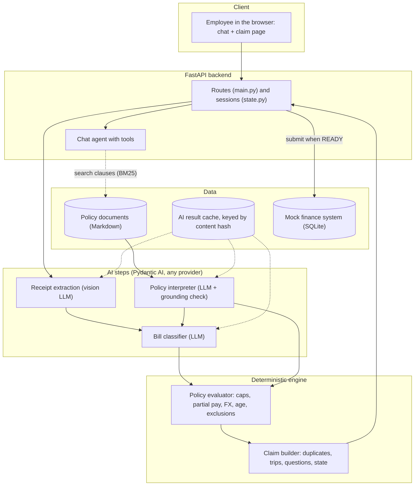
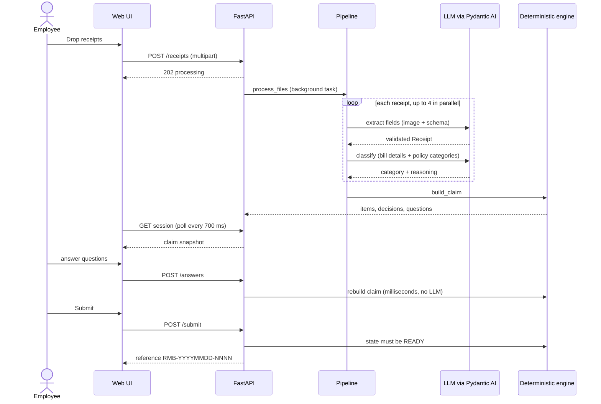
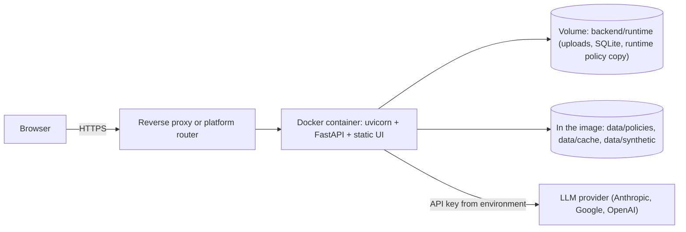
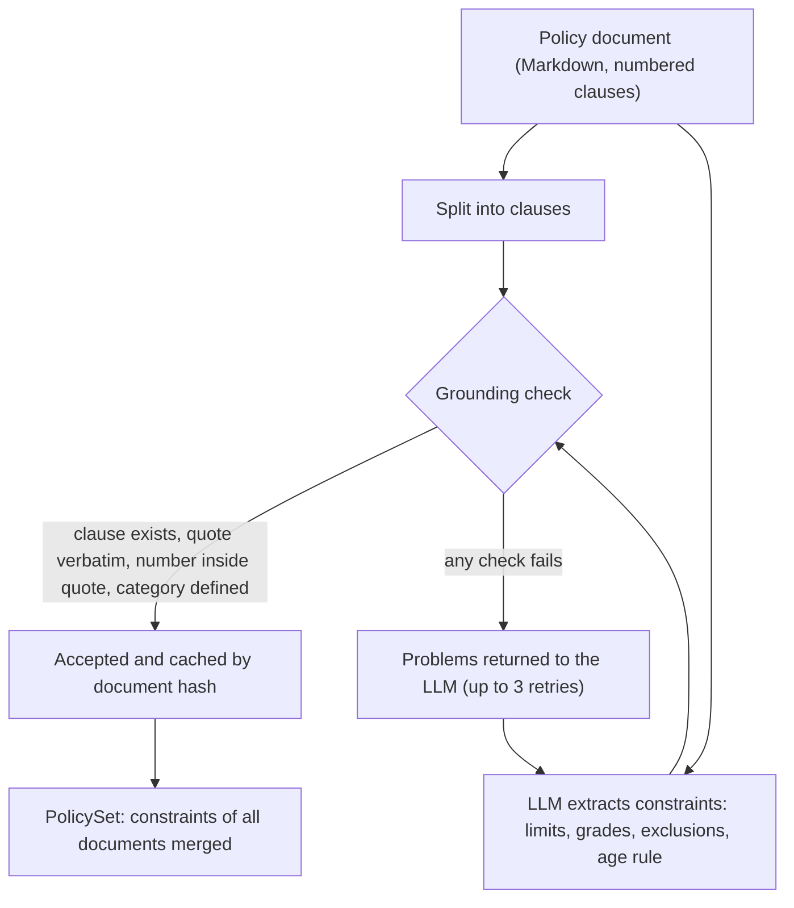
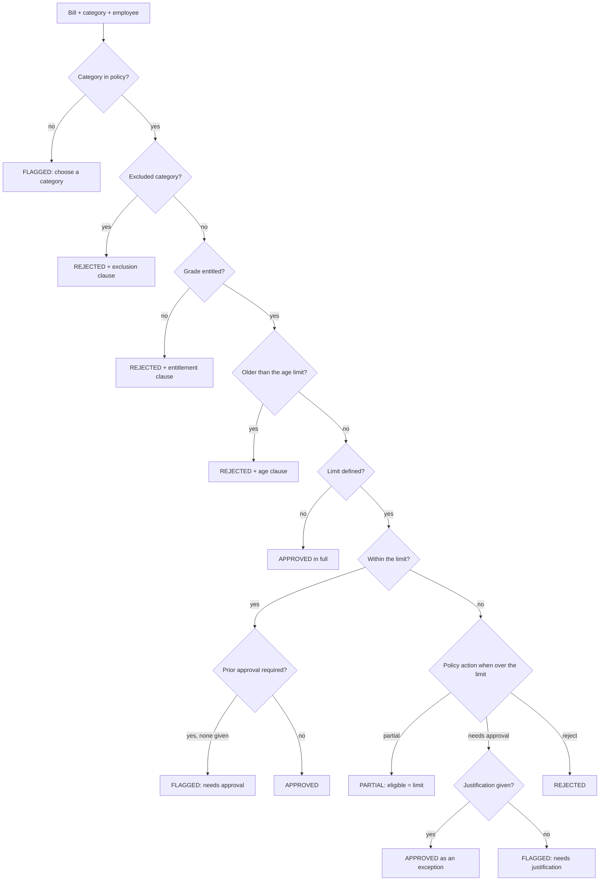
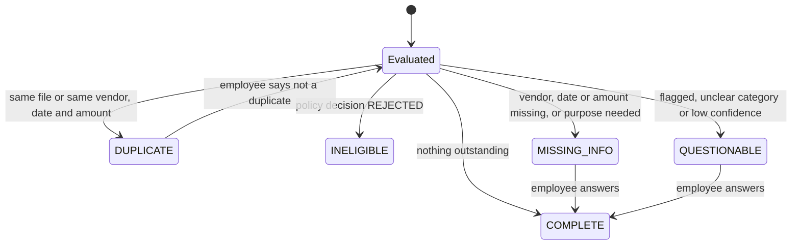
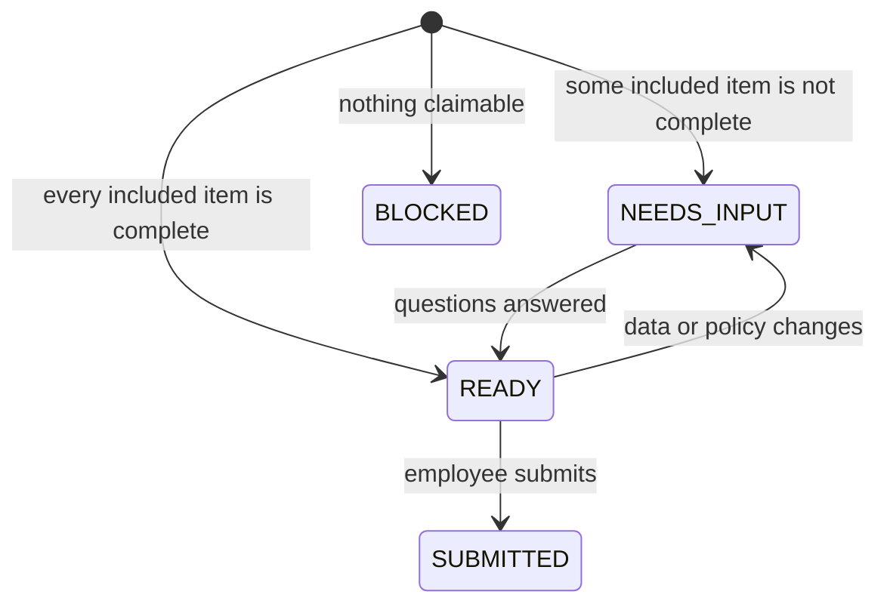
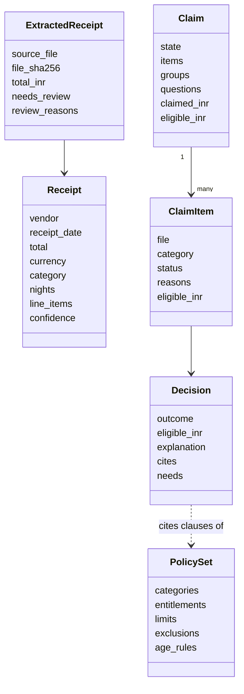

# Technical Design Document

**Project:** Expense & Reimbursement Agent  
**Competition track selected:** **Track 1 — "Expense & Reimbursement Agent"** (an AI-native assistant that turns a pile of
receipts into a submission-ready reimbursement claim)  
**Status:** complete and tested. 133 automated tests, 100% statement coverage of the `app/` package, lint clean.  
**Data:** 100% synthetic; the company ("Acme Corp"), policies, employee and receipts are fictional (see `DATA_POLICY.md`).

Contents: [1 Overview](#1-project-overview) · [2 Requirements](#2-requirements-and-traceability) ·
[3 Architecture](#3-system-architecture) · [4 AI design](#4-ai-design) · [5 Claim logic](#5-claim-logic) ·
[6 Data model](#6-data-model) · [7 API and UI](#7-api-and-ui) · [8 Code walkthrough](#8-code-walkthrough) ·
[9 Assumptions](#9-assumptions-and-limitations) · [10 Security and privacy](#10-security-and-privacy) ·
[11 Testing](#11-testing-and-reliability) · [12 Setup and deployment](#12-setup-and-deployment) · [13 Future work](#13-future-work)

---

## 1. Project overview

### 1.1 Problem (Track 1)
Employees regularly spend time collecting bills, entering details, categorising expenses, checking what is allowed and
preparing reimbursement claims. The track asks for an AI-native reimbursement assistant on a familiar interface (chat) where an
employee drops in photographs, PDFs or other bills and the system does as much of the work as possible: understand receipts,
extract information, group expenses, notice missing details, ask only necessary questions, check basic rules, identify possible
duplicates and prepare a submission-ready claim. The corporate reimbursement system may be mocked.

### 1.2 Solution in one paragraph
The employee drops bills into a web chat page. A vision LLM reads every bill into a validated structure. A second LLM step **reads the
company's policy documents** and converts them into structured, **quote-grounded constraints**; a third classifies each bill into the
employee's policy categories and explains why. **Deterministic code** then applies the constraints with exact arithmetic (caps per
receipt/night/day/month, partial reimbursement, FX conversion, age limit, exclusions, grade entitlements), removes duplicates, groups bills
into trips and works out the **minimum set of questions** the employee must answer. An agent in the chat explains any decision with the policy
clause and a verbatim quote, searches the policy, and records answers. A ready claim is submitted to a mock finance system (SQLite).
**Editing a policy document changes the outcome without any code change.**

### 1.3 What is novel
| Idea | Why it matters |
|---|---|
| **Policy as a document, interpreted by AI, enforced by code** | No limits or eligibility rules are hard-coded (`grep` finds none in `backend/app`). Change one sentence in a policy and the next claim uses it |
| **Grounding check on every AI-extracted rule** | A constraint is accepted only if its clause exists, its quote is verbatim, its number is inside that quote and its category is defined; failures are fed back to the LLM. This is what makes LLM-read policy safe for money |
| **Explanations that cite the exact clause** | Every decision carries clause references (e.g. `TEP-2.1`), the verbatim quote, the arithmetic and what is still needed |
| **Minimum questions** | 24 bills produce 5 questions: one business-purpose question per trip, none for bills the policy already rejected, clarification only when the answer changes the outcome *and* the model is unsure |
| **Measured engineering decisions** | Image hashing for duplicates was tested and rejected (different bills hashed identically); duplicates use content equality with a bill-number guard |
| **Model-agnostic, offline-capable** | `LLM_MODEL` switches providers; AI results are cached by content hash, so the demo runs with no key or network |

### 1.4 Scope
In scope: bill reading, policy interpretation, classification, validation, explanation, duplicate detection, grouping, minimal questions,
chat assistant, mock submission, evaluation harness, tests, deployment recipe. Out of scope / mocked: the real finance platform, authentication,
real HRMS employee data, approval workflows, live FX rates.

---

## 2. Requirements and traceability

| # | Requirement (brief or added AI requirement) | Feature | Module(s) | Tests |
|---|---|---|---|---|
| T1 | Understand receipts, extract information | Vision extraction into a validated `Receipt` | `ingest.py`, `extraction.py`, `models.py`, `quality.py` | `test_ingest`, `test_extraction`, `test_quality` |
| T2 | Group expenses | Date-proximity trip groups | `grouping.py` | `test_grouping` |
| T3 | Notice missing details, ask only necessary questions | Missing-field, purpose, justification, clarification questions | `claim.py` | `test_claim`, `test_edge_cases` |
| T4 | Check basic rules | Deterministic policy evaluation | `policy/evaluator.py` | `test_policy_evaluator`, `test_edge_cases` |
| T5 | Identify duplicates | Identical-file and same-bill detection | `duplicates.py` | `test_duplicates` |
| T6 | Submission-ready claim; mock finance | Claim state machine, SQLite submission | `claim.py`, `finance.py` | `test_claim`, `test_finance`, `test_api` |
| T7 | Fastest, clearest user experience | Chat + claim page, one-click demo, inline answers | `frontend/index.html`, `chat.py` | `test_api`, `test_chat_helpers` |
| A1 | AI-based eligibility identification | LLM reads entitlement matrix; code matches the employee's grade | `policy/interpreter.py`, `policy/schema.py` | `test_policy_interpreter`, `test_policy_evaluator` |
| A2 | Intelligent bill classification and mapping | LLM classifier into the policy's own categories, with reasoning | `classifier.py` | `test_classifier` |
| A3 | AI-powered policy interpretation and validation | Interpreter + evaluator, partial reimbursement recommended | `policy/*` | `test_policy_*` |
| A4 | Adapt to policy changes with no code change | Cache by document hash; UI policy editor; claims recomputed | `policy/interpreter.py`, `state.py`, `main.py` | `test_state`, `test_api` |
| A5 | Explainable decisions | Category reasoning, clause citation, quote, amounts, needs | `policy/evaluator.py`, `claim.py`, UI "Why?" | `test_policy_evaluator`, `test_claim` |
| A6 | Reliable execution | AI proposes, deterministic code enforces; grounding, retries, caching | whole backend | all |

---

## 3. System architecture

### 3.1 Component architecture



### 3.2 Processing flow (one upload)



### 3.3 Deployment view



### 3.4 Technology choices
| Layer | Choice | Why |
|---|---|---|
| Language | Python 3.11+ | Best ecosystem for LLM tooling and PDF/image handling |
| AI framework | **Pydantic AI 2.x** | Typed structured output, automatic validation retries, tools, provider-agnostic model strings; far lighter than LangChain/LangGraph for a fixed pipeline |
| Models | Claude Sonnet 5.5 (default); Gemini verified on free tier | Vision + structured output; swap with one env var |
| API | FastAPI + uvicorn | Async, typed, auto-docs at `/docs` |
| PDF/image | PyMuPDF, Pillow | Rasterise PDFs, strip EXIF, resize |
| Retrieval | BM25 (own 30-line implementation) | Two short documents do not justify embeddings; offline, deterministic, free |
| Storage | SQLite (stdlib `sqlite3`) for the mock finance system; in-memory sessions | No infrastructure to run |
| UI | One HTML file, plain JavaScript | No build step; DOM built without `innerHTML` (model output is untrusted) |
| Quality | pytest, pytest-cov, ruff, GitHub Actions | Tests, coverage gate, lint |

---

## 4. AI design

### 4.1 Where LLMs are used, and where they are not

| Step | Technique | Rationale |
|---|---|---|
| Receipt extraction | LLM (vision) | Photos and PDFs are messy |
| Policy interpretation | LLM + deterministic grounding check | Policies are prose that changes |
| Classification | LLM (text) with the policy's categories | A judgement call that must be explained |
| Amounts, caps, partial pay, FX, age limit | **Deterministic** | Financial accuracy, reproducibility, audit |
| Duplicates, grouping, statuses, questions | **Deterministic** | Testable, explainable |
| Chat | Agent with tools | Open-ended follow-ups; it reads decisions and records answers, code decides |
| Clause lookup | RAG (BM25) | Cites the exact clause in answers |

### 4.2 Receipt extraction (`extraction.py`, `ingest.py`)
1. `ingest.py` re-encodes every image to JPEG (this **drops EXIF/GPS**), resizes to at most 1,600 px, rasterises up to 3 PDF pages at 150 dpi
   and captures any embedded PDF text. The SHA-256 of the original bytes identifies the file.
2. A Pydantic AI agent with `output_type=Receipt` returns vendor, date, total, tax, currency, a free-text expense description, hotel nights,
   line items, bill number and **per-field confidence**. Field validators (e.g. 3-letter currency code) trigger automatic LLM retries.
3. `quality.assess_receipt` adds deterministic review reasons (missing fields, confidence < 0.7, line items not adding up to the total within 2%).
4. The **file name is never sent** to the model (it could leak the expected answer); a test enforces this.
5. Results are cached by file hash + model. Transient errors (HTTP 429/503, dropped connection) retry with 2, 4, 8, 16, 30 s back-off; a *daily*
   quota error is not retried because waiting cannot help.

### 4.3 Policy interpretation with a grounding check (`policy/interpreter.py`)



The LLM fills a `PolicyConstraints` object: `categories`, `entitlements` (category → grade codes), `limits` (amount, unit
`per_receipt|per_night|per_day|per_month`, grades, what happens over the limit: `partial|needs_approval|reject`, whether prior approval is required),
`exclusions` and `age_rules`. `grounding_problems()` verifies, for every item: the clause number exists; the quote is a whitespace- and
case-insensitive substring of that clause; the category id is defined in the same output; for limits and age rules, the number appears in the
quote. Violations are returned to the model as a `ModelRetry` listing each problem. Later documents are told the category ids defined by earlier
ones so documents agree on ids. **Because results are cached by the document's content hash, editing the document is the only thing needed for new
limits to apply.**

### 4.4 Classification (`classifier.py`)
A text-only LLM call receives the employee (grade, role), the policy's categories with a label for this employee
(`available to grade M2`, `NOT available`, `never reimbursable`) and the extracted bill. It returns one category id (validated against the policy),
a reasoning sentence, a confidence and, only when the choice would change the outcome, a clarification question. The instructions forbid asking
about things collected elsewhere (purpose, date, amount, tax). In code, a clarification is only shown if confidence is also below 0.75. This removed
four unnecessary questions in testing.

### 4.5 Deterministic evaluation (`policy/evaluator.py`)



Worked example from the brief: hotel limit INR 5,000 per night, bill INR 7,168 → `PARTIAL`, eligible INR 5,000, explanation
*"The bill is INR 7,168 but the limit is INR 5,000 per night x 1. Reimbursing INR 5,000; the excess INR 2,168 is not reimbursable. Policy TEP-2.1: "Hotel accommodation is reimbursable up to INR 5,000 per night.""*
with citations `GE-2.2` (why a manager may claim lodging) and `TEP-2.1`. Per-day and per-month limits are shared across receipts through a
`UsageTracker`. Grade-specific limits take precedence over general ones. Foreign currency is converted first.

### 4.6 Chat agent and retrieval (`chat.py`, `policy/clauses.py`)
A Pydantic AI agent with four tools: `claim_status`, `explain_item`, `search_policy` (BM25 over clauses; returns references such as `TEP-2.1`) and
`record_answer` (validated, then the claim is rebuilt by code). The agent's instructions forbid guessing amounts or policy and tell it to cite clause
references. It never decides: all numbers come from tool output produced by deterministic code.

### 4.7 Reliability engineering
| Risk | Mitigation |
|---|---|
| LLM invents a limit | Grounding check; retries with the exact problems listed |
| LLM returns malformed data | Pydantic validation + automatic retries; then a clear "enter manually" path, never a crash |
| Rate limits / overload / network drop | Back-off retries; daily quota not retried; per-file failure isolation |
| Provider outage or no key during a demo | Content-hash caches make the demo run offline |
| Privacy leakage via photos | EXIF/GPS stripped on re-encode |
| Prompt-leaking filenames | File name never sent |
| Untrusted model text in the UI | DOM built with `textContent`; only `**bold**` rendered, as `<b>` nodes |

### 4.8 Measured results (24 synthetic receipts, Claude Sonnet 5.5)
Extraction of vendor, date, total, currency: **24/24**. Category: **21/24 (88%)** with `anthropic:claude-sonnet-5-5` — classification accuracy is LLM-dependent and varies by model. Duplicates:
**3/3**, no false alarms. Questions asked: **5 for 24 bills**. Policy edit (hotel 5,000 → 7,000): reimbursable total INR 23,053 → INR 26,549 with no code
change. Gemini 3.8 Flash (free tier) interpreted the policy identically; of 8 receipts attempted, 5 completed (all correct) and 3 hit HTTP 503 overload, so no
full-set figure is claimed. Raw metrics: `data/eval/`.

---

## 5. Claim logic (`claim.py`, `duplicates.py`, `grouping.py`)

**Duplicates.** Walk the receipts in order; a receipt duplicates the first earlier one that has the identical file hash or the same date, currency,
amount (±0.01) and a similar vendor (`difflib` ratio ≥ 0.85 on normalised names). If both bills have bill numbers and they differ, they are two real
purchases. Image hashing was measured and rejected: on same-template receipts different bills had hash distance 0 and a re-photographed duplicate
had distance 34.

**Trips.** Dated bills are sorted; a bill within 3 days of the previous one joins its group; otherwise a new group starts (`g-<ISO start date>`).

**Item and claim states**





**Minimal questions.** `field` (basics first, then nothing else for that bill), `clarify` (only if outcome-relevant and confidence < 0.75),
`justify` (flagged by policy), `confirm` (low-confidence extraction), and one `purpose` per trip group. Bills already rejected ask nothing.

---

## 6. Data model



Persistence: sessions live in memory; submitted claims are stored in SQLite table `claims(id, created_at, employee_id, employee_name, grade,
claimed_inr, eligible_inr, status, payload JSON)` with references `RMB-YYYYMMDD-NNNN`. AI results are JSON files under `data/cache/` keyed by
content hash.

---

## 7. API and UI

| Endpoint | Purpose |
|---|---|
| `POST /api/sessions` | new session |
| `POST /api/sessions/{id}/receipts` | upload bills (202, background processing) |
| `POST /api/sessions/{id}/demo` | load the 24 bundled synthetic bills |
| `GET /api/sessions/{id}` | poll status and claim snapshot |
| `POST /api/sessions/{id}/answers` | answer a question or correct a field |
| `POST /api/sessions/{id}/chat` | talk to the agent |
| `POST /api/sessions/{id}/submit` | submit a ready claim to the mock finance system |
| `GET/PUT /api/policy`, `POST /api/policy/reset` | view, edit and restore policy documents |
| `GET /api/finance/claims[/{id}]` | submitted claims |
| `GET /api/health` | liveness and configured model |

Interactive docs: `/docs` (FastAPI). UI: chat on the left, claim on the right (summary, open questions with inline inputs, bills grouped by trip with
status chips, a **Why?** panel per bill), a **Policy** tab (edit text, see what the AI extracted) and a **Finance** tab.

---

## 8. Code walkthrough

| File | Responsibility and key points |
|---|---|
| `app/config.py` | `Settings` dataclass from environment/`.env`; all paths are derived from the project root so the app runs from any directory |
| `app/models.py` | `Receipt` (the schema the LLM must fill, with descriptions that double as instructions) and `ExtractedReceipt` (adds hash, INR total, review reasons, error) |
| `app/ingest.py` | Image/PDF loading, EXIF stripping, resizing, hashing; raises `UnsupportedFileError` for bad files |
| `app/extraction.py` | Extraction agent, shared `_run_with_backoff`, cache, failure result; the file name is never sent |
| `app/quality.py` | Deterministic post-extraction checks and their exact review messages |
| `app/currency.py` | Static illustrative FX table and `to_inr` |
| `app/policy/schema.py` | Constraint models and `PolicySet` queries (`limit_for` prefers grade-specific limits; `eligible_categories(grade)`) |
| `app/policy/clauses.py` | Clause parser (`N.M` lines under `##` headings), document codes (`TEP`, `GE`), BM25 `ClauseIndex` with a plural stemmer |
| `app/policy/interpreter.py` | Interpreter agent, `grounding_problems`, content-hash cache, multi-document merge with shared category ids |
| `app/policy/evaluator.py` | The decision procedure in §4.5; the only place money rules live; returns `Decision` with citations |
| `app/classifier.py` | Classification agent, category list rendering per employee, cache, safe fallbacks |
| `app/duplicates.py`, `app/grouping.py` | §5 |
| `app/claim.py` | `build_claim` orchestrates three stages: `_triage` (dedupe + policy evaluation), `_assess_item` (status and minimal questions per receipt), `_assemble` (state and totals); `_purpose_questions` adds one question per trip |
| `app/pipeline.py` | Runs extraction then classification for many files concurrently (4 at a time); one bad file never sinks the batch |
| `app/state.py` | In-memory sessions, runtime copy of the policies, background processing, `apply_answer` validation, `reload_policy` |
| `app/chat.py` | Agent, tools, summaries and explanations |
| `app/finance.py` | SQLite mock of the corporate system |
| `app/main.py` | FastAPI routes, input limits (40 files, 10 MB each), error mapping (503 missing key, 502 AI failure), static UI |
| `frontend/index.html` | The whole UI |
| `tools/` | `generate_receipts.py` (synthetic data), `run_pipeline.py` (end-to-end evaluation), `extract_receipts.py`, `make_deck.py` |

Design conventions: pure functions where possible (`build_claim`, `evaluate_line`, `grounding_problems` take inputs and return outputs); I/O at the edges
(`state.py`, `main.py`, the agents); dependency injection of agents and settings so tests substitute fake models; every error path returns an explicit,
user-readable result instead of raising into the UI.

---

## 9. Assumptions and limitations

**Assumptions**
1. Policy documents are Markdown with numbered clauses (`N.M text`) and state limits with their numbers in the same sentence.
2. Grade codes and category names come from the policy documents; one employee profile is loaded per deployment.
3. Receipts use day-first dates; amounts are totals including tax; limits are per receipt, per night (nights from the bill, default 1), per day (receipt date) or per calendar month.
4. One category per bill; bills are English; currencies INR, USD, EUR, GBP, SGD, AED at static illustrative rates.
5. A "needs approval" exception is satisfied in this prototype by a recorded justification (no real approval workflow).
6. A business purpose is required (policy clause 1.2): one answer per trip group; a trip is bills within 3 days of each other.
7. "Today" is pinned with `CLAIM_TODAY` (2026-10-12) so the 60-day rule is repeatable for the demo.

**Limitations**
- Measured on synthetic bills; real receipts are messier. No authentication. Sessions are in memory (one process). Policy interpretation assumes
  clearly numbered clauses. Free-tier LLMs rate-limit and overload (handled, but visible). LLM cost per claim was not measured.

---

## 10. Security and privacy
- Synthetic data only; no company information, no PII, no real policies (see `DATA_POLICY.md`).
- API keys only in a git-ignored `.env` (or platform secrets); `.env.example` has placeholders; CI uses a dummy key.
- EXIF/GPS metadata is stripped before any image leaves the process; uploads are limited to images/PDFs, 40 files, 10 MB each; file names are reduced to their base name.
- All model-generated text is rendered with `textContent`/DOM nodes; no `innerHTML` with dynamic content.
- The prototype has **no authentication**; do not host it publicly with a paid key without a proxy or access control (see `docs/SETUP_AND_DEPLOYMENT.md`).

---

## 11. Testing and reliability
133 automated tests run offline in about 4 seconds: unit tests for every module, integration tests of the claim pipeline over 24 synthetic bills with ground
truth, API tests (success paths and every error branch) and agent-tool tests driven by scripted fake models, so **no test calls an LLM**. Statement
coverage of `app/` is **100%** (1,380 statements, measured with `pytest-cov`), enforced at ≥ 95% in CI together with `ruff`. Details, per-module coverage and the
live-LLM evaluation are in [`docs/TEST_REPORT.md`](TEST_REPORT.md).

## 12. Setup and deployment
Local install, configuration, Docker and hosting recipes are in [`docs/SETUP_AND_DEPLOYMENT.md`](SETUP_AND_DEPLOYMENT.md). Quick start:
```bash
python3 -m venv .venv && source .venv/bin/activate
pip install -r backend/requirements.txt && cp .env.example .env     # add your key
cd backend && CLAIM_TODAY=2026-10-12 uvicorn app.main:app --port 8000   # open http://localhost:8000
```

## 13. Future work
Real HRMS grades and location tiers (city-tier hotel caps); embedding-based retrieval for large policy libraries; multi-category bills and trip-level caps;
approval workflow and real finance integration; authentication and per-user sessions; live FX; mobile capture.

## Glossary
**Clause reference** `TEP-2.1` = document code (initials of the file name) + clause number. **Grounding** = proving an AI-extracted rule is backed by the
document text. **Outcome** = `approved`, `partial`, `flagged`, `rejected`. **Warm cache** = AI results already stored for the configured model.
